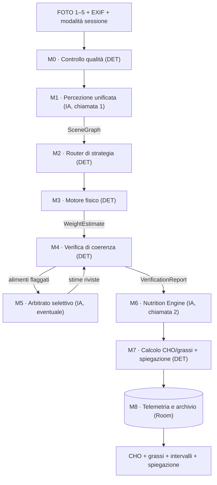

# UgoCalc – Inference Engine V2

**Documento tecnico di implementazione**

*Data: 6 luglio 2026*
*Stato: motore M0–M8 implementato e testato in isolamento (unit test + test end-to-end `V2AnalysisPipelineTest`). Non ancora collegato alla UI di produzione: l'app installata usa oggi la pipeline V1 (`RunVisionForModelsUseCase` → `AiOrchestrator.runVisionAnalysis`). Il collegamento è tracciato come lavoro residuo in §13.*

Questo documento descrive l'architettura del motore di inferenza V2, **cosa di questa architettura è stato effettivamente scritto e testato nel codice**, e il ragionamento tecnico dietro ogni scelta. I riferimenti `§n` usati nel codice (`domain/inference/model/*.kt` e nei commenti sorgente) corrispondono alla numerazione dei paragrafi qui sotto.

Ogni sezione di modulo riporta esplicitamente lo **stato di implementazione**, i **file coinvolti** e le **deviazioni** rispetto a quanto originariamente pensato, quando presenti: l'obiettivo è che questo documento resti vero leggendo il codice, non che descriva un'intenzione.

---

## 1. Visione

UgoCalc esiste per contare i carboidrati dei pasti in modo più accurato e rapido di quanto si possa fare a occhio. La V1, oggi in produzione, usa un singolo passaggio di visione artificiale (foto → alimenti + pesi stimati) seguito dall'abbinamento con le tabelle nutrizionali locali. Funziona, con un errore medio sui pesi intorno al **12,5%**.

La V2 non è un aggiustamento di prompt: è un **motore di inferenza** composto da moduli indipendenti, ciascuno con una responsabilità precisa, testabile separatamente e sostituibile senza toccare il resto. Ogni stima deve essere spiegabile: se l'app dice "165 g di riso", deve poter mostrare da dove viene quel numero.

L'app si usa **sia a casa sia al ristorante**; il motore è progettato per funzionare in entrambi i contesti (§8), anche se — come dettagliato più sotto — la selezione di contesto non ha ancora un'interfaccia utente.

## 2. Principio di progetto e motivazione

> **I moduli basati su IA percepiscono e propongono; i moduli deterministici decidono e calcolano.**

Un modello multimodale è molto bravo a riconoscere alimenti, leggere una scena, stimare dimensioni relative. Non è affidabile nell'aritmetica né nella coerenza numerica tra più stime: chiedergli direttamente i grammi significa chiedergli la cosa che sa fare peggio. Da qui tre decisioni architetturali di fondo, tutte implementate:

1. **Percezione unificata in un'unica chiamata (M1), non passi separati.** Ricostruzione scena, identificazione alimenti e misure grezze condividono lo stesso input (le foto): separarli in chiamate distinte moltiplicherebbe costo e latenza e comporrebbe gli errori senza possibilità di recupero (un errore al passo 1 avvelena i passi successivi, che non rivedono più le foto). Un modello moderno svolge queste percezioni meglio insieme che separate. La modularità si ottiene nei **contratti dati** tra moduli (§7), non nel numero di chiamate IA.

2. **La stima della quantità è codice deterministico (M3), non un output del modello.** L'IA fornisce dimensioni, conteggi e frazioni di riempimento; le formule fanno il resto. Questo è, per costruzione, il singolo punto con il maggior impatto atteso sulla precisione, perché sposta l'aritmetica dal componente meno affidabile (il modello) al componente più controllabile e testabile (il codice).

3. **La tassonomia degli alimenti è definita per strategia di calcolo, non per geometria.** La categoria di un alimento serve a una cosa sola: scegliere *come calcolarne il peso*. Definire le categorie per come un cibo *appare* (solido, granulare, liquido...) mescola metodi di calcolo diversi sotto la stessa etichetta; definirle per *come si calcolano* (§6) rende ogni categoria coerente con un'unica formula.

Di conseguenza:

- l'IA **non produce mai grammi** per gli alimenti a stima geometrica: produce dimensioni, conteggi, frazioni di riempimento, riferimenti di scala;
- la **conversione in grammi è codice deterministico**, su tabelle locali di densità e pesi unitari, coperto da test automatici;
- ogni numero finale porta con sé la propria **catena di calcolo** (formula, valori, fonti): è questo che rende ogni stima spiegabile e verificabile.

## 3. Vincoli di progetto

- **Nessun training né hosting di modelli propri**: tutta l'IA passa dai provider già integrati (OpenAI, Anthropic, Google Gemini) con chiave API dell'utente.
- **Tutta la logica deterministica gira on-device**, in Kotlin, senza backend.
- **Budget: 2 chiamate al modello per analisi** nel caso normale (M1 percezione, M6 abbinamento nutrizionale); una **terza solo se** la verifica M4 rileva incoerenze (M5).
- **Nessuna catena lunga di chiamate sequenziali**: moduli che condividono lo stesso input restano accorpati in un'unica chiamata.
- **Provider intercambiabili**: contratti dati JSON neutrali rispetto al provider, come nella V1.
- **La modalità Casa/Ristorante è pensata come scelta esplicita dell'utente** a inizio sessione, mai dedotta dalla foto (§8) — l'enum e la logica a valle esistono; l'interfaccia per sceglierla non è ancora stata costruita (§13).

## 4. Architettura generale e stato di collegamento

Otto moduli in sequenza logica. Etichette: `[DET]` = deterministico on-device, `[IA]` = chiamata a modello multimodale.

```
FOTO (1–5) + EXIF + Modalità sessione (Casa/Ristorante)
        |
        v
[DET] M0 – Controllo qualità e ingestione
        |
        v
[IA – chiamata 1] M1 – Percezione unificata
        |            (scala + inventario + misure grezze)
        |  SceneGraph
        v
[DET] M2 – Router di strategia
        |  (alimento → una delle 6 strategie)
        v
[DET] M3 – Motore fisico
        |  (misure grezze → grammi, con catena di calcolo)
        |  WeightEstimate
        v
[DET] M4 – Verifica di coerenza ---- alimenti flaggati ----> [IA – eventuale] M5 – Arbitrato selettivo
        |                                                          |
        |<------------------- stime riviste ---------------------- +
        v
[IA – chiamata 2] M6 – Nutrition Engine (abbinamento tabelle + ricerca online di riserva)
        |
        v
[DET] M7 – Calcolo CHO e grassi + report di spiegazione
        |
        v
[DET] M8 – Telemetria e archivio di apprendimento (Room)
        |
        v
OUTPUT: CHO + grassi + intervalli + spiegazione per alimento
```



**Stato di collegamento (importante per interpretare correttamente il resto del documento).** `V2AnalysisPipeline` e `V2AnalysisPipelineFactory` orchestrano M0→M8 e hanno un test end-to-end (`V2AnalysisPipelineTest`), ma **non sono ancora iniettati in nessun ViewModel dell'app**. `CameraCaptureViewModel` e `VisionResultsViewModel` chiamano tuttora la pipeline V1 (`AiOrchestrator.runVisionAnalysis`). In altre parole: il motore descritto in questo documento esiste, è testato modulo per modulo, ma **l'utente non lo sta ancora usando**. Il collegamento alla UI è il prossimo passo di sviluppo (§13), non un dettaglio implementativo minore.

Nel caso normale, una volta collegato, l'intero flusso costerà **due** chiamate al modello; la terza (M5) scatterà solo su anomalia rilevata da M4.

## 5. Moduli: stato, implementazione e motivazione

**M0 – Controllo qualità e ingestione** `[DET]` — **implementato (logica di decisione), isolato**
File: `domain/inference/m0/QualityGate.kt`, test in `m0/QualityGateTest.kt`.
`QualityGate.assess(List<PhotoQuality>)` riceve metriche già calcolate (nitidezza, luminosità, hash percettivo a 64 bit) e applica soglie fisse (nitidezza minima da varianza Laplaciana, luminosità in un intervallo, distanza di Hamming ≤10 per i duplicati), producendo un `IngestionResult` con foto valide/scartate e motivo. Se tutte le foto sono scadenti, l'esito lo dichiara esplicitamente (zero chiamate consumate).
**Cosa manca:** il calcolo reale di queste metriche da un Bitmap Android (estrazione nitidezza/luminosità/hash da una foto vera) non è stato scritto: `QualityGate` oggi riceve input già pronti, nei test e nella pipeline. Manca anche il collegamento ai metadati EXIF (§16) per diagnosticare foto mosse tramite tempo di esposizione/ISO, come inizialmente previsto: quella logica non esiste ancora.

**M1 – Percezione unificata** `[IA – chiamata 1]` — **implementato, isolato dall'app**
File: `domain/inference/m1/UnifiedPerceptionEngine.kt`, `m1/PerceptionPrompt.kt`; contratto in `domain/inference/model/SceneGraph.kt`. Test: `m1/PerceptionPromptTest.kt`, `m1/SceneGraphReferenceCasesTest.kt`.
Riusa `AiCallExecutor` (lo stesso executor della V1) per codificare le foto e chiamare il modello con `completeJson<SceneGraph>(...)`. Il prompt chiede esplicitamente ancore di scala + inventario + misure grezze — **mai grammi** — con un ordine di ancore diverso a seconda della modalità di sessione (regola testuale nel prompt). Ogni risposta dichiara `schema_version` (`SceneGraph.SCHEMA_VERSION = 1`); un fallimento di parsing propaga un fallback dichiarato in stile V1 (`PerceptionOutcome.FallbackAV1`), mai spacciato per un risultato V2.

**M2 – Router di strategia** `[DET]` — **completo e testato**
File: `domain/inference/m2/StrategyRouter.kt`, `m2/StrategyRules.kt`; test `m2/StrategyRouterTest.kt`.
Una tabella dati (`StrategyRules.DEFAULT`) di keyword italiane normalizzate (minuscolo, accenti rimossi, match a parola intera) mappa un nome alimento a una delle 6 strategie (§6). Se nessuna regola combacia, sceglie un **fallback prudente** basato sulle misure disponibili (es. un conteggio presente → Contabile; una frazione di riempimento → Contenitore). Uno `SceneGraph` con `schema_version` non riconosciuta viene **rifiutato esplicitamente**, mai deserializzato parzialmente.

**M3 – Motore fisico** `[DET]` — **completo, il modulo con più codice e test; una semplificazione nota**
File: `domain/inference/m3/PhysicalData.kt` (tabelle densità/pesi unitari/capacità), `m3/PhysicsEngine.kt` (le 6 formule), `m3/ScaleResolver.kt` (ancore → contesto di scala). Test: `PhysicalDataTest.kt`, `PhysicsEngineTest.kt`, `ScaleResolverTest.kt`.
Formule per strategia: Contabile = conteggio × peso unitario; Distesa = frazione piatto × area piatto × altezza × riempimento × densità; Contenitore = capacità × riempimento × densità; Blocco = volume secondo forma dichiarata (cilindro/cuneo/parallelepipedo) × densità; Trascurabile = valore fisso dichiarato incerto. Ogni stima produce una `CalculationChain` (formula, valori, fonti) e un intervallo di confidenza la cui ampiezza dipende da occlusione, confidenza IA, qualità della scala e uso di default fisici. `ScaleResolver` sceglie l'ancora di priorità più alta disponibile (§8) e ripiega su un contesto di default (27 cm, qualità bassa) se nessuna ancora è utilizzabile.
**Semplificazione nota:** la strategia **Composto** riusa oggi la formula di Blocco (volume geometrico × densità media) invece di fare una vera ripartizione da ricetta per gli ingredienti occlusi (lasagne, farciti): funziona come stima del peso *totale*, non separa i CHO tra i componenti nascosti.
**Punto scollegato più importante del modulo:** `PhysicsEngine.estimate()` non consulta mai i fattori di correzione da bias (§8/M8): la catena di calcolo non applica né dichiara alcun fattore di correzione. Il sistema di bias esiste (calcolato in M8) ma oggi non influenza il peso calcolato.

**M4 – Verifica di coerenza** `[DET]` — **completo, con un proxy dichiarato nel codice**
File: `domain/inference/m4/ConsistencyVerifier.kt`; test `m4/ConsistencyVerifierTest.kt`.
Controlla: peso assoluto entro un range plausibile; densità superficiale del piatto (per alimenti "distesa"); somma delle frazioni di piatto coperte ≤ 1.2 (margine di errore di percezione); ambiguità identificativa quando esistono alternative di identificazione e la confidenza non è alta. Il vincolo di ambiguità usa oggi un **proxy** (presenza di alternative + confidenza non alta) invece di verificare se l'alternativa cambia davvero i CHO, perché richiederebbe di consultare le tabelle di M6 — commentato esplicitamente nel codice come raffinamento da aggiungere quando M6 sarà collegato a M4.
**Cosa manca rispetto all'idea originale:** una regola di sicurezza per cui, se un'ambiguità resta irrisolta dopo M5, il sistema sceglie automaticamente l'alternativa con CHO più alto e segnala la necessità di conferma manuale (scelta prudente per un'app che informa dosi di insulina — sottostimare i CHO è l'errore peggiore, sovrastimare su un alimento dichiaratamente incerto è recuperabile). Questa regola **non è implementata**: `VerificationReport` non ha un campo di ambiguità residua, e `V2AnalysisPipeline` non sceglie mai esplicitamente l'alternativa più cautelativa. È tracciata come lavoro da fare in §13.

**M5 – Arbitrato selettivo** `[IA – eventuale]` — **completo, wiring corretto**
File: `domain/inference/m5/SelectiveArbitrationEngine.kt`, `m5/ArbitrationPrompt.kt`; contratti in `domain/inference/model/ArbitrationContracts.kt`. Test: `m5/ArbitrationPromptTest.kt`.
Si attiva solo se M4 produce alimenti flaggati; il prompt porta solo le foto originali e l'elenco dei dubbi, per una rianalisi mirata al costo minimo possibile. Viene invocato **al massimo una volta** per analisi: se l'ambiguità resta dopo il ritorno di M5, la pipeline prosegue con le stime pre-arbitrato dichiarando esplicitamente il motivo mancante, senza rientrare in un loop.

**M6 – Nutrition Engine** `[IA – chiamata 2]` — **completo, riuso deliberato della V1**
File: `domain/inference/m6/NutritionMatchStepAdapter.kt`.
È un adattatore puro: converte le `WeightEstimate` di M3 nello stesso contratto `RecognizedFood` già usato dalla V1 e chiama `MatchFoodsAcrossTablesUseCase` esistente (tabelle Room + ricerca online OpenFoodFacts di riserva). Nessuna riscrittura, perché quel componente è già solido e collaudato in produzione: riscriverlo non avrebbe aggiunto valore, solo rischio.

**M7 – Calcolo carboidrati e grassi + spiegazione** `[DET]` — **completo**
File: `domain/inference/m7/NutritionCalculator.kt`; test `m7/NutritionCalculatorTest.kt`.
Calcolo puro: CHO = CHO/100g × peso/100 (stesso per grassi), con la spiegazione per alimento presa direttamente dalla catena di calcolo di M3 ("165 g perché: piatto Ø 26 cm × 45% coperto × 2,1 cm altezza × riempimento 0,8 × densità riso 0,72 g/cm³"). Gli alimenti senza abbinamento nutrizionale sono esclusi dai totali, mai stimati a zero in silenzio.

**M8 – Telemetria e archivio di apprendimento** `[DET, Room]` — **parzialmente implementato: la persistenza c'è, il ciclo di auto-miglioramento non è chiuso**
File: entity `V2AnalysisRecordEntity.kt`, DAO `V2AnalysisRecordDao.kt`, repository `V2TelemetryRepository.kt`; calcolatore `domain/inference/m8/BiasCorrectionCalculator.kt` con entity/DAO/repository `BiasCorrectionEntity/Dao/Repository`; UI di sola lettura `BiasEvolutionScreen.kt`/`BiasEvolutionViewModel.kt`. Test: `BiasCorrectionCalculatorTest.kt`, `BiasCorrectionRepositoryTest.kt`, `V2TelemetryRepositoryTest.kt`.

Ciò che funziona: `V2TelemetryRepository.record()` salva l'intero esito di un'analisi (SceneGraph, stime di peso, report di verifica, report nutrizionale) in colonne JSON, con modalità di sessione, modello IA e versione di schema. `BiasCorrectionCalculator.calculate()` implementa l'algoritmo di taratura: richiede almeno 5 osservazioni, verifica che almeno l'80% concordi sul segno dello scarto stimato/reale, e in tal caso restituisce come fattore correttivo la **mediana** dei rapporti (robusta agli outlier) — altrimenti dichiara esplicitamente dati insufficienti o bias instabile, senza mai inventare un fattore. `BiasCorrectionRepository` mantiene la chiave esatta *(modalità, strategia, modello IA)*, mai un'aggregazione cross-modello, dietro un flag di consenso esplicito dell'utente (`SettingsRepository.biasDataConsentGiven`, aggiunto per motivi di privacy, non previsto nella prima stesura del piano).

Ciò che manca per chiudere il ciclo:
1. Non esiste alcuna UI per l'utente per registrare un peso vero o una correzione manuale collegata a un record M8: `recordGroundTruth()` non viene mai chiamato fuori dai test.
2. Non esiste alcun trigger automatico (job periodico, evento all'apertura dell'app) che richiami `recalculate()`: il ricalcolo del bias è codice raggiungibile solo dai test.
3. `PhysicsEngine` (M3) non chiama mai `currentFactor()`: anche un fattore calcolato non verrebbe applicato al peso stimato. `BiasEvolutionScreen` è oggi un pannello di sola trasparenza, non un anello di retroazione.

Di conseguenza, il meccanismo di "il sistema impara dai propri errori e si corregge nel tempo" ha **l'infrastruttura dati e l'algoritmo pronti e testati**, ma non è ancora un ciclo automatico attivo: manca la raccolta di ground truth in UI, il trigger di ricalcolo, e il consumo del fattore in M3. Sono i tre pezzi mancanti tracciati in §13.

## 6. Tassonomia degli alimenti per strategia di stima

La categoria serve a un solo scopo: **scegliere come calcolare il peso**. Sei strategie, definite in `EstimationStrategy.kt` e implementate in M2/M3:

| Strategia | Esempi | Metodo di calcolo |
|---|---|---|
| **Contabile** | frutta intera, polpette, biscotti, fette | n° pezzi × peso unitario di riferimento |
| **Distesa sul piatto** | pasta, riso, insalate, contorni | superficie coperta × altezza × riempimento × densità |
| **A contenitore** | latte, minestre, yogurt, succhi | capacità × frazione di riempimento × densità |
| **Blocco misurabile** | carne, pesce, torte, formaggio, pane a fetta | forma geometrica × dimensioni × densità |
| **Composto / occluso** | lasagne, ripieni, sughi coprenti, panini farciti | volume geometrico totale × densità media (oggi: nessuna ripartizione da ricetta, vedi §5 M3) |
| **Trascurabile** | olio, spolverate, salse leggere | valore fisso di riferimento, dichiarato incerto |

Ogni categoria corrisponde a un'unica formula testabile con casi noti calcolati a mano (§11). La strategia **Trascurabile** esiste perché fingere di stimare 8 g di olio da una foto sarebbe falsa precisione, non perché richieda un calcolo complesso.

## 7. Contratti dati tra moduli

Ogni modulo riceve e restituisce **JSON strutturato** (kotlinx.serialization). Regola generale: **ogni valore numerico viaggia con la propria incertezza e la propria provenienza**. L'IA propone dimensioni/conteggi/riempimenti, mai grammi (§2).

**M1 → M2: `SceneGraph`** (implementato in `SceneGraph.kt`)

```json
{
  "ancore": [
    { "tipo": "stoviglia_calibrata", "descrizione": "piatto piano bianco",
      "dimensione_reale_cm": 26.0, "confidenza": "alta" }
  ],
  "alimenti": [
    { "nome": "riso in bianco",
      "alternative_identificazione": ["riso basmati"],
      "occlusione": "nessuna",
      "misure_grezze": {
        "frazione_piatto": 0.45, "altezza_cm": 2.1, "riempimento": 0.8,
        "nota": "cumulo uniforme al centro del piatto"
      },
      "confidenza": "alta" }
  ],
  "sovrapposizioni": [ { "sopra": "ragù", "sotto": "pasta" } ]
}
```

**M3 → M4: `WeightEstimate`** — per ciascun alimento: strategia usata, peso stimato, intervallo di confidenza, catena di calcolo completa:

```json
{
  "alimento": "riso in bianco",
  "strategia": "distesa",
  "peso_g": 165,
  "intervallo_g": [130, 205],
  "catena_di_calcolo": {
    "formula": "area_piatto × frazione × altezza × riempimento × densità",
    "valori": { "area_piatto_cm2": 380.1, "frazione": 0.45, "altezza_cm": 2.1,
                "riempimento": 0.8, "densita_g_cm3": 0.72 },
    "fonti": { "area_piatto_cm2": "stoviglia_calibrata Ø26",
               "densita_g_cm3": "tabella_densita v3" }
  }
}
```

Nota: il campo `fattore_correzione` immaginato in fase di progetto (per tracciare l'applicazione di un bias appreso, §8) **non è ancora popolato**, perché M3 non consulta i fattori di correzione (§5 M3). Quando il collegamento sarà fatto, questo è il punto dove il valore comparirà nella catena.

**M4 → M5/M6: `VerificationReport`** — esito di ciascun vincolo e alimenti flaggati con motivo:

```json
{
  "vincoli": [ { "nome": "densita_superficiale_piatto", "esito": "ok" },
               { "nome": "somma_superfici", "esito": "ok" } ],
  "flag": [ { "alimento": "lasagna", "motivo": "peso fuori intervallo tipico (620 g)" } ]
}
```

Il campo `ambiguita_residua` (con la regola "CHO più alto in caso di dubbio irrisolto") descritto in fase di progetto **non esiste ancora in questo contratto** — è lavoro non fatto, non una scelta di design cambiata (§5 M4, §13).

**M8: record di analisi** — copia integrale dei documenti precedenti + versioni (schema, modello, engine) + modalità di sessione + eventuale ground truth:

```json
{
  "ground_truth": { "peso_reale_g": 170, "fonte": "pesata", "livello": "gold" }
}
```

Livelli di ground truth: **Gold** = bilancia; **Silver** = etichetta/fonte affidabile; **Bronze** = stima dell'utente. Il campo esiste nello schema e nel DB (`recordGroundTruth`); manca solo l'interfaccia utente che lo popoli (§5 M8, §13).

**Versionamento dello schema `SceneGraph`.** Il prompt di M1 e le data class Kotlin che deserializzano il suo output devono evolvere insieme: ogni modifica allo schema è un cambio di `schema_version` numerico. M2 rifiuta esplicitamente (errore gestito, non crash) un `SceneGraph` con `schema_version` non riconosciuta — verificato in `StrategyRouterTest.kt`.

## 8. Modalità Casa/Ristorante e calibrazione — stato reale

`SessionMode.kt` (enum `CASA`/`RISTORANTE`) esiste ed è consumato dal prompt di M1 (ordine delle ancore di scala) e dalla telemetria di M8. **Non esiste però alcuna interfaccia utente per selezionarla**: nessuno switch Casa/Ristorante in nessuna schermata dell'app; ogni chiamata a M1 nei test usa un valore impostato dal chiamante, non da una scelta reale dell'utente.

**Ancore di scala**, implementate e testate in `ScaleResolver`/`ScaleAnchorType` (ordine di priorità: stoviglia calibrata > riferimento corporeo > oggetto universale > stima generica): il resolver sceglie l'ancora di priorità più alta dichiarata da M1 nella foto corrente. **Non esiste memoria tra una sessione e l'altra**: non ci sono tabelle Room per calibrazione stoviglie personali né per riferimenti corporei personali — ogni analisi riparte da zero sull'ancoraggio, senza poter riusare una calibrazione fatta in precedenza.

**Fattori di correzione appresi** (§5 M8): l'algoritmo di taratura (mediana dei rapporti peso-vero/peso-stimato, soglia minima di campioni, verifica di concordanza del segno) è implementato e testato in isolamento in `BiasCorrectionCalculator`, con chiave sempre esatta *(modalità, strategia, modello IA)* — mai un'aggregazione cross-modello, perché il bias nasce nella percezione (M1) ed è specifico di quel modello: applicare senza distinzione il fattore calcolato su un modello a una lettura fatta da un altro andrebbe nella direzione sbagliata. Ma **il fattore non viene mai consumato da M3** (§5 M3): l'infrastruttura di calcolo esiste, il ciclo di retroazione automatico no.

**In sintesi, delle quattro componenti previste per §8 — switch di modalità in UI, calibrazione stoviglie, riferimenti corporei, applicazione automatica del bias — nessuna è oggi operativa per l'utente finale.** Esiste l'infrastruttura dati e algoritmica sottostante (enum, resolver, calcolatore di bias, DB); mancano l'interfaccia utente e i tre collegamenti che chiuderebbero il ciclo (§13).

## 9. Rischi e colli di bottiglia

| Gravità | Rischio | Mitigazione / stato |
|---|---|---|
| **Alta** | L'errore si compone tra i moduli e la V2 rende peggio della V1 | Percezione unificata in un'unica chiamata (M1); **il confronto sul benchmark previsto (§10) non è ancora stato eseguito** — nessun dato reale a supporto ancora raccolto |
| **Alta** | Assenza di scala affidabile, soprattutto al ristorante | Ancore corporee e universali come prima linea in `ScaleResolver`; in assenza totale, confidenza dichiarata bassa (implementato e testato) |
| **Alta** | Il motore M0–M8 è pronto ma non collegato alla UI: il lavoro rischia di restare inutilizzato | Collegamento a `CameraCaptureViewModel`/`VisionResultsViewModel` è il prossimo passo tracciato in §13, non un dettaglio rimandabile indefinitamente |
| Media | Tabella densità incompleta o imprecisa | File dati versionato (`PhysicalData.kt`), correggibile senza toccare la logica di calcolo |
| Media | Il modello non rispetta il formato atteso | Validazione rigida dello schema, fallback su stima diretta stile V1 (implementato in M1/M5) |
| Media | Il bias calcolato non viene mai applicato, quindi il sistema non migliora usandolo | Vedi §5 M8/§8: i tre collegamenti mancanti sono in cima alla lista di §13 |
| Media | Composti/occlusi restano difficili (nessuna ripartizione da ricetta) | Intervalli di confidenza ampi mostrati esplicitamente; ripartizione da ricetta non implementata (§5 M3) |
| **Sempre presente** | Una stima errata influenza una decisione clinica (dose di insulina) | Intervalli sempre visibili nella catena di calcolo; la regola di sicurezza "CHO più alto su ambiguità irrisolta" **non è ancora implementata** (§5 M4) — priorità alta in §13 |

**Colli di bottiglia identificati:**

- **M1 resta il collo di bottiglia dell'accuratezza**: tutto ciò che sta a valle è deterministico, quindi l'errore residuo del sistema è dominato dalla qualità della percezione.
- **La tabella di densità è il collo di bottiglia di M3**: dati in `PhysicalData.kt`, migliorabili senza toccare il codice di calcolo.
- **Il collegamento mancante è oggi il collo di bottiglia più concreto**: un motore testato che non riceve traffico reale non genera i dati (ground truth, bias, benchmark) di cui ha bisogno per migliorare.

## 10. Piano di validazione — non ancora eseguito

Il benchmark pesato (30–50 pasti reali con peso vero registrato, in proporzione realistica casa/ristorante) è il prerequisito per qualunque confronto quantitativo V1/V2, ed è tuttora **da costruire**: non esiste nel repository alcun file relativo a un set di benchmark, né una modalità ombra che esegua la V2 in parallelo alla V1 su casi reali.

Piano previsto, in ordine:

- **Fase 0** — costruzione del benchmark + raccolta telemetria sulla V1 attuale; nessun cambiamento visibile in app.
- **Fase 1** — collegamento della pipeline V2 alla UI (§13), con la V1 ancora attiva.
- **Fase 2** — V2 attiva **in ombra**: l'app mostra ancora la V1 ma registra anche l'esito V2 su M8, per confronto diretto sugli stessi pasti reali.
- **Fase 3** — passaggio alla V2 **solo se supera la V1 sul benchmark**; la V1 resta disponibile come rete di sicurezza.
- **Fase 4** — chiusura del ciclo di bias (§5 M8, §8) e raffinamento continuo di tabelle fisiche.

Nessuna di queste fasi è iniziata: il lavoro fatto finora corrisponde alla costruzione del motore che queste fasi dovranno validare.

## 11. Piano di test — stato attuale

**Moduli deterministici** (M0, M2, M3, M4, M7): coperti da test automatici classici, esistenti nel repository:

- `QualityGateTest.kt` — soglie di nitidezza/luminosità/duplicati, caso "tutte scadenti".
- `StrategyRouterTest.kt` — ogni alimento della tabella va alla strategia attesa; fallback prudente su alimento sconosciuto; rifiuto di schema non riconosciuto.
- `PhysicalDataTest.kt`, `PhysicsEngineTest.kt`, `ScaleResolverTest.kt` — casi con valori noti calcolati a mano per ciascuna delle 6 strategie, casi limite, proprietà di monotonia.
- `ConsistencyVerifierTest.kt` — scena costruita per violare ciascun vincolo → flag col motivo giusto; scena coerente → nessun flag.
- `NutritionCalculatorTest.kt` — CHO = Σ(peso × CHO/100 g) su casi noti.

**Moduli IA** (M1, M5, M6): `PerceptionPromptTest.kt`, `SceneGraphReferenceCasesTest.kt`, `ArbitrationPromptTest.kt` verificano che l'output rispetti lo schema (deserializzazione rigida) e che il prompt costruito sia quello atteso. La suite va rieseguita a ogni cambio di prompt o modello — questa disciplina è rispettata nei test esistenti, ma **non esiste ancora la tolleranza numerica su un benchmark reale** (§10), perché il benchmark non esiste.

**Test end-to-end**: `V2AnalysisPipelineTest.kt` copre l'intera sequenza M0→M8 con dati sintetici, incluso il percorso di fallback e l'attivazione condizionale di M5.

## 12. Metriche di valutazione — definite, non ancora misurate

- **Primarie**: errore assoluto di CHO per pasto in grammi; percentuale di pasti con errore entro 10 g ed entro 20 g di CHO.
- **Diagnostiche**: errore percentuale medio sul peso per alimento, scomposto per strategia e per qualità dell'ancora di scala; percentuale di alimenti non rilevati o inventati.
- **Di sistema**: calibrazione della confidenza; copertura degli intervalli; frequenza di attivazione di M5; latenza e costo per analisi rispetto alla V1.

Queste metriche sono definite come obiettivo di misurazione per il benchmark di §10, che non è ancora stato costruito: **nessuna di queste metriche ha oggi un valore reale misurato per la V2**. Vanno riportate separatamente per Casa e Ristorante quando il benchmark esisterà.

## 13. Lavoro residuo (ordinato per impatto)

Questa sezione sostituisce l'idea di "sviluppi futuri fuori perimetro": qui sotto ci sono i collegamenti e le implementazioni mancanti già individuati leggendo il codice attuale, necessari perché il motore descritto nei §5–§8 diventi qualcosa che l'utente usa davvero.

1. **Collegare `V2AnalysisPipeline` alla UI** (`CameraCaptureViewModel`/`VisionResultsViewModel`), con uno switch esplicito Casa/Ristorante a inizio sessione. Finché questo non è fatto, tutto il resto del motore è codice testato ma inerte.
2. **Regola di sicurezza sull'ambiguità residua in M4**: dopo un tentativo di M5, un'identificazione ancora ambigua tra alternative con CHO diverso deve selezionare l'alternativa a CHO più alto e segnalarlo esplicitamente in UI come stima cautelativa da confermare. Priorità alta per un'app che informa dosi di insulina: sottostimare i CHO per eccesso di fiducia è l'errore peggiore possibile.
3. **Chiudere il ciclo di bias (§5 M8, §8)**: UI per registrare ground truth (peso vero o correzione manuale) collegata a un record M8; trigger automatico di ricalcolo (job periodico o all'apertura dell'app); consumo del fattore calcolato dentro `PhysicsEngine`. Sono tre pezzi separati, ciascuno piccolo, ma nessuno dei tre esiste oggi.
4. **Calibrazione persistente delle stoviglie e dei riferimenti corporei** (§8): tabelle Room dedicate, oggi inesistenti, così che una calibrazione fatta una volta non vada persa a ogni sessione.
5. **Costruire il benchmark pesato** (§10) e collegare le fasi di validazione in ombra: senza questo, non è possibile sapere se la V2 è davvero migliore della V1 prima di esporla agli utenti.
6. **Ripartizione da ricetta per la strategia Composto** (§5 M3, §6): oggi è un blocco geometrico rietichettato; una vera ripartizione tra ingredienti occlusi richiede una fonte di ricette (locale o online) non ancora progettata.
7. **Metadati camera per M0** (§16): oggi M0 non riceve dati EXIF/`CameraCharacteristics`; il collegamento serve a diagnosticare foto mosse o scattate con parametri anomali prima di consumare una chiamata IA.
8. **Export/import del record M8** (§17): oggi l'export copre cronologia V1, tabelle nutrizionali e fattori di bias, ma non `v2_analysis_records` — un cambio di telefono perderebbe lo storico di analisi V2 con ground truth.
9. **Changelog per-versione-modulo nelle release GitHub** (§15): il corpo della release oggi non dichiara quali versioni di motore/prompt/tabella densità sono cambiate.

Idee più a lungo termine, esplicitamente fuori da questo lavoro residuo perché hanno senso solo dopo che i punti 1–5 sono chiusi e M8 ha accumulato dati reali: dashboard di calibrazione automatica che segnala regressioni tra versioni, foto prima/dopo pasto per stimare il consumato dagli avanzi, mappa di profondità come ancora di scala aggiuntiva su dispositivi che la supportano, modelli multimodali on-device quando saranno affidabili (i contratti dati restano gli stessi, cambia solo il provider dietro M1). In tutti i casi, il cambio di prompt, strategia o modello in produzione resta una decisione dell'owner informata dal benchmark — nessun componente proposto qui deciderebbe da solo di cambiare l'architettura.

## 14. Decisioni chiave

| Ambito | Decisione |
|---|---|
| Percezione visiva | Una sola chiamata unificata per scala, inventario e misure grezze — implementata (M1) |
| Peso in grammi | Sempre calcolato dal motore fisico deterministico, mai dichiarato dal modello — implementato (M3) |
| Tassonomia alimenti | Sei categorie definite dalla strategia di calcolo, non dalla geometria — implementata (M2/M3) |
| Verifica | Sempre attiva e deterministica; il modello interviene solo sugli alimenti segnalati — implementata (M4/M5), manca solo la regola di sicurezza su ambiguità residua |
| Motore nutrizionale | Quello della V1, già solido, senza riscritture — implementato (M6) |
| Collegamento alla UI | **Non ancora fatto** — priorità più alta del lavoro residuo (§13) |
| Ancora di scala principale | Riferimenti corporei e universali, non le stoviglie di casa — implementata la logica (M3), manca la persistenza delle calibrazioni |
| Modalità di sessione | Pensata come selezione esplicita dell'utente, mai dedotta dall'immagine — enum e prompt pronti, UI mancante |
| Evoluzione del sistema | Algoritmo di taratura bias pronto e testato (M8); il ciclo automatico (raccolta → ricalcolo → applicazione) non è ancora chiuso |
| Prerequisito di validazione | Benchmark pesato (casa + ristorante) — da costruire prima di qualunque decisione su una release in produzione |

---

## 15. Distribuzione delle versioni tramite GitHub Releases

**Stato: implementato, con una lacuna specifica.** File: `data/remote/github/GitHubReleaseClient.kt`, `data/repository/UpdateRepository.kt`, `ui/settings/ChangelogScreen.kt`/`ChangelogViewModel.kt`, `domain/model/Changelog.kt`.

`GitHubReleaseClient.fetchLatestRelease()` chiama l'API pubblica REST di GitHub (`GET /repos/{owner}/{repo}/releases/latest`) senza token, estraendo tag, URL della pagina, corpo e l'asset `.apk`. `UpdateRepository.checkForUpdate()` confronta la versione installata con il tag remoto tramite confronto numerico segmento-per-segmento. Il controllo è **sempre manuale** (Impostazioni > Software e aggiornamenti), mai in background; il download resta delegato al browser di sistema. `Changelog.ENTRIES` è oggi una lista statica hardcoded in Kotlin (una sola voce, `2.0.0`), non letta dal corpo della release.

**Lacuna:** il corpo della release non dichiara quali versioni di motore/prompt/tabella densità sono cambiate (§7), quindi un record M8 con una certa combinazione di versioni non è ancora riconducibile a un changelog pubblico leggibile. Tracciato in §13.

## 16. Metadati del dispositivo per il calcolo del volume

**Stato: minimo, molto meno di quanto inizialmente previsto.** File: `ui/camera/CameraCaptureScreen.kt` (funzioni private `exifRotationDegrees`, `decodeUprightBitmap`).

L'unico uso reale di EXIF oggi è la lettura del tag `TAG_ORIENTATION` per ruotare correttamente l'anteprima della foto in galleria/zoom — i byte JPEG inviati all'IA non vengono mai toccati. **Non esiste alcuna classe `FotoMetadata`** nel repository: nessuna estrazione di lunghezza focale, apertura, tempo di esposizione, ISO, o dimensione fisica del sensore tramite `CameraCharacteristics`. Di conseguenza M0 non usa questi dati per abbassare la confidenza su foto mosse o esposte male, e M8 non li ha disponibili per diagnostica di benchmark.

Motivazione per farlo comunque (perché resta un'idea valida, solo non ancora costruita): calcolare una dimensione reale in centimetri da una foto 2D richiede comunque un'ancora nota o una distanza nota — questi metadati da soli non risolvono il problema della scala, ma migliorerebbero la diagnosi di foto inutilizzabili in M0 prima di consumare una chiamata IA. Tracciato in §13.

## 17. Import/export dei dati utente

**Stato: implementato quasi per intero, con un'omissione specifica su M8.** File: `data/backup/BackupDtos.kt` (`UgoCalcBackupArchive`, `schema_version = 1`), `data/repository/BackupRepository.kt`, `ui/settings/BackupScreen.kt`/`BackupViewModel.kt`.

`exportAll()` serializza in un unico archivio JSON: cronologia analisi V1, tabelle nutrizionali normalizzate, fattori di correzione bias, preferiti (collegati per indice di posizione, non per id, perché l'id cambia al reinserimento). Le chiavi API non entrano mai nell'archivio, per scelta di sicurezza esplicita. `previewImport()` valida `schema_version` (rifiuta versioni più recenti di quella supportata) e mostra un riepilogo di cosa verrà sostituito prima della conferma; `applyImport()` esegue **sostituzione totale**, mai merge silenzioso — le stesse ragioni di §5 M8 sulla difficoltà di arbitrare conflitti tra fattori di bias duplicati si applicano qui. Uso confermato di Storage Access Framework, nessun permesso di storage esteso.

**Omissione:** `v2_analysis_records` (lo storico M8 con ground truth) **non viene mai esportato né importato** — solo la cronologia V1 lo è. Un cambio di telefono perderebbe lo storico di analisi V2, pur mantenendo i fattori di bias già calcolati (quelli sì sono esportati). Tracciato in §13. Non esistono ancora tabelle di calibrazione stoviglie/riferimenti corporei da esportare, perché — come detto in §8 — quelle tabelle non esistono nel DB.

---

*Fine del documento.*
