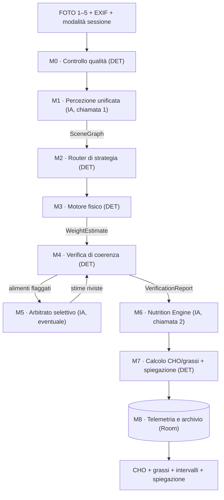

# UgoCalc – Inference Engine V2

**Documento tecnico di implementazione**

*Data: 6 luglio 2026*
*Stato: motore M0–M8 implementato e testato in isolamento (unit test + test end-to-end `V2AnalysisPipelineTest`) e collegato alla UI solo in **modalità ombra opzionale**. L'app installata mostra ancora il risultato V1 (`RunVisionForModelsUseCase` → `AiOrchestrator.runVisionAnalysis`); se abilitata, la V2 gira in background sugli stessi scatti e salva telemetria M8 senza sostituire la V1. Il passaggio a V2 come motore visibile resta lavoro residuo in §13.*

Questo documento descrive l'architettura del motore di inferenza V2, **cosa di questa architettura è stato effettivamente scritto e testato nel codice**, e il ragionamento tecnico dietro ogni scelta. I riferimenti `§n` usati nel codice (`domain/inference/model/*.kt` e nei commenti sorgente) corrispondono alla numerazione dei paragrafi qui sotto.

Ogni sezione di modulo riporta esplicitamente lo **stato di implementazione**, i **file coinvolti** e le **deviazioni** rispetto a quanto originariamente pensato, quando presenti: l'obiettivo è che questo documento resti vero leggendo il codice, non che descriva un'intenzione.

---

## 1. Visione

UgoCalc esiste per contare i carboidrati dei pasti in modo più accurato e rapido di quanto si possa fare a occhio. La V1, oggi in produzione, usa un singolo passaggio di visione artificiale (foto → alimenti + pesi stimati) seguito dall'abbinamento con le tabelle nutrizionali locali. Funziona, con un errore medio sui pesi intorno al **12,5%**.

La V2 non è un aggiustamento di prompt: è un **motore di inferenza** composto da moduli indipendenti, ciascuno con una responsabilità precisa, testabile separatamente e sostituibile senza toccare il resto. Ogni stima deve essere spiegabile: se l'app dice "165 g di riso", deve poter mostrare da dove viene quel numero.

L'app si usa **sia a casa sia al ristorante**; il motore è progettato per funzionare in entrambi i contesti (§8), anche se — come dettagliato più sotto — la selezione di contesto non ha ancora un'interfaccia utente.

## 2. Principio di progetto e motivazione

> **I moduli basati su IA percepiscono e propongono; i moduli deterministici decidono e calcolano.**

Un modello multimodale è molto bravo a riconoscere alimenti, leggere una scena, stimare dimensioni relative. Non è affidabile nell'aritmetica né nella coerenza numerica tra più stime: chiedergli direttamente i grammi significa chiedergli la cosa che sa fare peggio. Da qui tre decisioni architetturali di fondo, tutte implementate:

1. **Percezione unificata in un'unica chiamata (M1), non passi separati.** Ricostruzione scena, identificazione alimenti e misure grezze condividono lo stesso input (le foto): separarli in chiamate distinte moltiplicherebbe costo e latenza e comporrebbe gli errori senza possibilità di recupero (un errore al passo 1 avvelena i passi successivi, che non rivedono più le foto). Un modello moderno svolge queste percezioni meglio insieme che separate. La modularità si ottiene nei **contratti dati** tra moduli (§7), non nel numero di chiamate IA.

2. **La stima della quantità è codice deterministico (M3), non un output del modello.** L'IA fornisce dimensioni, conteggi e frazioni di riempimento; le formule fanno il resto. Questo è, per costruzione, il singolo punto con il maggior impatto atteso sulla precisione, perché sposta l'aritmetica dal componente meno affidabile (il modello) al componente più controllabile e testabile (il codice).

3. **La tassonomia degli alimenti è definita per strategia di calcolo, non per geometria.** La categoria di un alimento serve a una cosa sola: scegliere *come calcolarne il peso*. Definire le categorie per come un cibo *appare* (solido, granulare, liquido...) mescola metodi di calcolo diversi sotto la stessa etichetta; definirle per *come si calcolano* (§6) rende ogni categoria coerente con un'unica formula.

Di conseguenza:

- l'IA **non produce mai grammi** per gli alimenti a stima geometrica: produce dimensioni, conteggi, frazioni di riempimento, riferimenti di scala;
- la **conversione in grammi è codice deterministico**, su tabelle locali di densità e pesi unitari, coperto da test automatici;
- ogni numero finale porta con sé la propria **catena di calcolo** (formula, valori, fonti): è questo che rende ogni stima spiegabile e verificabile.

## 3. Vincoli di progetto

- **Nessun training né hosting di modelli propri**: tutta l'IA passa dai provider già integrati (OpenAI, Anthropic, Google Gemini) con chiave API dell'utente.
- **Tutta la logica deterministica gira on-device**, in Kotlin, senza backend.
- **Budget: 2 chiamate al modello per analisi** nel caso normale (M1 percezione, M6 abbinamento nutrizionale); una **terza solo se** la verifica M4 rileva incoerenze (M5).
- **Nessuna catena lunga di chiamate sequenziali**: moduli che condividono lo stesso input restano accorpati in un'unica chiamata.
- **Provider intercambiabili**: contratti dati JSON neutrali rispetto al provider, come nella V1.
- **La modalità Casa/Ristorante è pensata come scelta esplicita dell'utente** a inizio sessione, mai dedotta dalla foto (§8) — l'enum e la logica a valle esistono; l'interfaccia per sceglierla non è ancora stata costruita (§13).

## 4. Architettura generale e stato di collegamento

Otto moduli in sequenza logica. Etichette: `[DET]` = deterministico on-device, `[IA]` = chiamata a modello multimodale.

```
FOTO (1–5) + EXIF + Modalità sessione (Casa/Ristorante)
        |
        v
[DET] M0 – Controllo qualità e ingestione
        |
        v
[IA – chiamata 1] M1 – Percezione unificata
        |            (scala + inventario + misure grezze)
        |  SceneGraph
        v
[DET] M2 – Router di strategia
        |  (alimento → una delle 6 strategie)
        v
[DET] M3 – Motore fisico
        |  (misure grezze → grammi, con catena di calcolo)
        |  WeightEstimate
        v
[DET] M4 – Verifica di coerenza ---- alimenti flaggati ----> [IA – eventuale] M5 – Arbitrato selettivo
        |                                                          |
        |<------------------- stime riviste ---------------------- +
        v
[IA – chiamata 2] M6 – Nutrition Engine (abbinamento tabelle + ricerca online di riserva)
        |
        v
[DET] M7 – Calcolo CHO e grassi + report di spiegazione
        |
        v
[DET] M8 – Telemetria e archivio di apprendimento (Room)
        |
        v
OUTPUT: CHO + grassi + intervalli + spiegazione per alimento
```



**Stato di collegamento (importante per interpretare correttamente il resto del documento).** `V2AnalysisPipeline` e `V2AnalysisPipelineFactory` orchestrano M0→M8 e hanno un test end-to-end (`V2AnalysisPipelineTest`). `CameraCaptureViewModel` continua a eseguire la V1 come flusso visibile, ma oggi può avviare anche la V2 in **modalità ombra** tramite `runV2ShadowAnalysisIfEnabled()`, se l'utente abilita lo switch in `BiasEvolutionScreen`. La shadow pipeline usa gli stessi scatti, la modalità Casa/Ristorante scelta in Home e il primo modello selezionato; eventuali errori restano confinati al background e non interrompono mai la V1. In altre parole: il motore descritto in questo documento riceve traffico reale solo quando la modalità ombra è attiva, ma **non è ancora il motore mostrato all'utente**. La promozione della V2 a flusso visibile resta lavoro residuo (§13).

Nel caso normale, una volta collegato, l'intero flusso costerà **due** chiamate al modello; la terza (M5) scatterà solo su anomalia rilevata da M4.

## 5. Moduli: stato, implementazione e motivazione

**M0 – Controllo qualità e ingestione** `[DET]` — **implementato (logica di decisione), isolato**
File: `domain/inference/m0/QualityGate.kt`, test in `m0/QualityGateTest.kt`.
`QualityGate.assess(List<PhotoQuality>)` riceve metriche già calcolate (nitidezza, luminosità, hash percettivo a 64 bit) e applica soglie fisse (nitidezza minima da varianza Laplaciana, luminosità in un intervallo, distanza di Hamming ≤10 per i duplicati), producendo un `IngestionResult` con foto valide/scartate e motivo. Se tutte le foto sono scadenti, l'esito lo dichiara esplicitamente (zero chiamate consumate).
**Stato Android reale:** il calcolo delle metriche da JPEG è stato aggiunto in `util/PhotoQualityMetrics.kt`: luminanza sottocampionata, varianza del Laplaciano, brightness medio e hash percettivo 64 bit. Nella modalità ombra `CameraCaptureViewModel` passa a M0 anche il picco di movimento vicino allo scatto (`GyroscopeMotionTracker`) e i metadati EXIF disponibili (`extractCameraMetadata`: ISO, tempo di esposizione, focale, apertura). Rimane mancante l'uso di `CameraCharacteristics`/dimensione fisica del sensore e M0 non applica ancora soglie su ISO/esposizione: quei metadati sono diagnostici, non criteri di scarto automatico.

**M1 – Percezione unificata** `[IA – chiamata 1]` — **implementato, isolato dall'app**
File: `domain/inference/m1/UnifiedPerceptionEngine.kt`, `m1/PerceptionPrompt.kt`; contratto in `domain/inference/model/SceneGraph.kt`. Test: `m1/PerceptionPromptTest.kt`, `m1/SceneGraphReferenceCasesTest.kt`.
Riusa `AiCallExecutor` (lo stesso executor della V1) per codificare le foto e chiamare il modello con `completeJson<SceneGraph>(...)`. Il prompt chiede esplicitamente ancore di scala + inventario + misure grezze — **mai grammi** — con un ordine di ancore diverso a seconda della modalità di sessione (regola testuale nel prompt). Ogni risposta dichiara `schema_version` (`SceneGraph.SCHEMA_VERSION = 1`); un fallimento di parsing propaga un fallback dichiarato in stile V1 (`PerceptionOutcome.FallbackAV1`), mai spacciato per un risultato V2.

**M2 – Router di strategia** `[DET]` — **completo e testato**
File: `domain/inference/m2/StrategyRouter.kt`, `m2/StrategyRules.kt`; test `m2/StrategyRouterTest.kt`.
Una tabella dati (`StrategyRules.DEFAULT`) di keyword italiane normalizzate (minuscolo, accenti rimossi, match a parola intera) mappa un nome alimento a una delle 6 strategie (§6). Se nessuna regola combacia, sceglie un **fallback prudente** basato sulle misure disponibili (es. un conteggio presente → Contabile; una frazione di riempimento → Contenitore). Uno `SceneGraph` con `schema_version` non riconosciuta viene **rifiutato esplicitamente**, mai deserializzato parzialmente.

**M3 – Motore fisico** `[DET]` — **completo, il modulo con più codice e test; una semplificazione nota**
File: `domain/inference/m3/PhysicalData.kt` (tabelle densità/pesi unitari/capacità), `m3/PhysicsEngine.kt` (le 6 formule), `m3/ScaleResolver.kt` (ancore → contesto di scala). Test: `PhysicalDataTest.kt`, `PhysicsEngineTest.kt`, `ScaleResolverTest.kt`.
Formule per strategia: Contabile = conteggio × peso unitario; Distesa = frazione piatto × area piatto × altezza × riempimento × densità; Contenitore = capacità × riempimento × densità; Blocco = volume secondo forma dichiarata (cilindro/cuneo/parallelepipedo) × densità; Trascurabile = valore fisso dichiarato incerto. Ogni stima produce una `CalculationChain` (formula, valori, fonti) e un intervallo di confidenza la cui ampiezza dipende da occlusione, confidenza IA, qualità della scala e uso di default fisici. `ScaleResolver` sceglie l'ancora di priorità più alta disponibile (§8) e ripiega su un contesto di default (27 cm, qualità bassa) se nessuna ancora è utilizzabile.
**Composto – comportamento attuale e miglioramento ibrido implementato:** originariamente la strategia **Composto** riutilizzava la formula di Blocco (volume geometrico × densità media) per stimare il peso totale senza separare i CHO fra i componenti occulti (lasagne, ripieni, panini farciti). Questa semplificazione resta il fallback. Tuttavia, è stata implementata una soluzione ibrida: quando M3 produce una `WeightEstimate` con strategia `COMPOSTO_OCCLUSO` e confidenza `ALTO`, M6 tenta una ricerca di ricetta nel database locale (`RecipeRepository.findByNameFuzzy`). Se viene trovata una ricetta con ingredienti, il peso totale stimato viene ripartito proporzionalmente alle percentuali degli ingredienti della ricetta e ogni ingrediente viene passato singolarmente al matching nutrizionale (M6 → `MatchFoodsAcrossTablesUseCase`). Se non si trova una ricetta o la confidenza non è sufficiente, si ricade sulla stima totale (comportamento Blocco). La decomposizione normalizza le percentuali se non sommano a 100 e viene annotata nella voce con metadati strutturati (vedi §7 contratti dati). Questa modifica migliora l'accuratezza sui piatti composti riutilizzando il DB ricette esistente e mantenendo un fallback prudente quando necessario.
**Punto scollegato più importante del modulo:** `PhysicsEngine.estimate()` non consulta mai i fattori di correzione da bias (§8/M8): la catena di calcolo non applica né dichiara alcun fattore di correzione. Il sistema di bias esiste (calcolato in M8) ma oggi non influenza il peso calcolato.

**M4 – Verifica di coerenza** `[DET]` — **completo, con un proxy dichiarato nel codice**
File: `domain/inference/m4/ConsistencyVerifier.kt`; test `m4/ConsistencyVerifierTest.kt`.
Controlla: peso assoluto entro un range plausibile; densità superficiale del piatto (per alimenti "distesa"); somma delle frazioni di piatto coperte ≤ 1.2 (margine di errore di percezione); ambiguità identificativa quando esistono alternative di identificazione e la confidenza non è alta. Il vincolo di ambiguità usa oggi un **proxy** (presenza di alternative + confidenza non alta) invece di verificare se l'alternativa cambia davvero i CHO, perché richiederebbe di consultare le tabelle di M6 — commentato esplicitamente nel codice come raffinamento da aggiungere quando M6 sarà collegato a M4.
**Regola di sicurezza sull'ambiguità residua — implementata (§13 punto 2).** Se dopo un tentativo di M5 un alimento ha ancora alternative di identificazione aperte, `V2AnalysisPipeline.risolviAmbiguitaResidua()` (chiamata da `finalizza()`, quindi su ogni percorso: nessun flag, M5 riuscito, M5 non disponibile) cerca il CHO/100g di ciascun candidato (nome originale + alternative) tramite lo step iniettabile `AmbiguityResolutionStep` e sceglie quello con CHO più alto — mai sottostimare i carboidrati su un'identificazione incerta, sovrastimare su un alimento dichiaratamente incerto resta l'errore recuperabile. La scelta rinomina l'alimento nello `SceneGraph` finale e nella `WeightEstimate` corrispondente (così M6 abbina la nutrizione al nome scelto) e viene dichiarata in `VerificationReport.ambiguitaRisolta` (§7), pronta per la UI quando la V2 sarà un flusso visibile (§13 punto 1). Se nessun candidato è riconosciuto, l'alimento resta invariato: l'ambiguità resta comunque segnalata da `flaggati`, semplicemente non "risolta" per difetto.
`V2AnalysisPipelineFactory` collega oggi questo step a una ricerca **locale e deterministica** (`TableRepository.searchEntries`, la stessa ricerca manuale delle tabelle utente): nessuna terza chiamata al modello, quindi resta nel budget di due chiamate (§4).

**M5 – Arbitrato selettivo** `[IA – eventuale]` — **completo, wiring corretto**
File: `domain/inference/m5/SelectiveArbitrationEngine.kt`, `m5/ArbitrationPrompt.kt`; contratti in `domain/inference/model/ArbitrationContracts.kt`. Test: `m5/ArbitrationPromptTest.kt`.
Si attiva solo se M4 produce alimenti flaggati; il prompt porta solo le foto originali e l'elenco dei dubbi, per una rianalisi mirata al costo minimo possibile. Viene invocato **al massimo una volta** per analisi: se l'ambiguità resta dopo il ritorno di M5, la pipeline prosegue con le stime pre-arbitrato dichiarando esplicitamente il motivo mancante, senza rientrare in un loop.

**M6 – Nutrition Engine** `[IA – chiamata 2]` — **completo, riuso deliberato della V1**

Nota: l'adapter M6 è stato esteso per supportare la decomposizione ibrida dei piatti composti (vedi sopra). In breve:

- Quando M3 riporta strategia `COMPOSTO_OCCLUSO` e confidenza `ALTO`, M6 prova a cercare una ricetta locale tramite `RecipeRepository.findByNameFuzzy` e, se trovata, ripartisce il `pesoG` totale fra gli ingredienti proporzionalmente alle percentuali della ricetta. Gli ingredienti risultanti vengono inviati separatamente al matching nutrizionale.
- È stata aggiunta una ricerca fuzzy semplice (substring case-insensitive) come fallback dopo il match esatto; il repository espone `findByNameFuzzy` che prova l'exact match, poi la ricerca per sottostringa.
- Le voci generate dalla decomposizione includono metadati opzionali `DecompositionInfo` (id ricetta, nome ricetta, percentuale) in modo che la UI possa mostrare la fonte della decomposizione senza rompere la compatibilità.

Queste estensioni mantengono il comportamento di fallback (Blocco) quando non è possibile decomporre e permettono di migliorare l'accuratezza per piatti noti riutilizzando il DB ricette esistente.
File: `domain/inference/m6/NutritionMatchStepAdapter.kt`.
È un adattatore puro: converte le `WeightEstimate` di M3 nello stesso contratto `RecognizedFood` già usato dalla V1 e chiama `MatchFoodsAcrossTablesUseCase` esistente (tabelle Room + ricerca online OpenFoodFacts di riserva). Nessuna riscrittura, perché quel componente è già solido e collaudato in produzione: riscriverlo non avrebbe aggiunto valore, solo rischio.

**M7 – Calcolo carboidrati e grassi + spiegazione** `[DET]` — **completo**
File: `domain/inference/m7/NutritionCalculator.kt`; test `m7/NutritionCalculatorTest.kt`.
Calcolo puro: CHO = CHO/100g × peso/100 (stesso per grassi), con la spiegazione per alimento presa direttamente dalla catena di calcolo di M3 ("165 g perché: piatto Ø 26 cm × 45% coperto × 2,1 cm altezza × riempimento 0,8 × densità riso 0,72 g/cm³"). Gli alimenti senza abbinamento nutrizionale sono esclusi dai totali, mai stimati a zero in silenzio.

**M8 – Telemetria e archivio di apprendimento** `[DET, Room]` — **parzialmente implementato: la persistenza c'è, il ciclo di auto-miglioramento non è chiuso**
File: entity `V2AnalysisRecordEntity.kt`, DAO `V2AnalysisRecordDao.kt`, repository `V2TelemetryRepository.kt`; calcolatore `domain/inference/m8/BiasCorrectionCalculator.kt` con entity/DAO/repository `BiasCorrectionEntity/Dao/Repository`; UI di trasparenza `BiasEvolutionScreen.kt`/`BiasEvolutionViewModel.kt`, che ora mostra anche statistiche d'uso dei fattori appresi. Test: `BiasCorrectionCalculatorTest.kt`, `BiasCorrectionRepositoryTest.kt`, `V2TelemetryRepositoryTest.kt`.

Ciò che funziona: `V2TelemetryRepository.record()` salva l'intero esito di un'analisi (SceneGraph, stime di peso, report di verifica, report nutrizionale) in colonne JSON, con modalità di sessione, modello IA e versione di schema. `BiasCorrectionCalculator.calculate()` implementa l'algoritmo di taratura: richiede almeno 5 osservazioni, verifica che almeno l'80% concordi sul segno dello scarto stimato/reale, e in tal caso restituisce come fattore correttivo la **mediana** dei rapporti (robusta agli outlier) — altrimenti dichiara esplicitamente dati insufficienti o bias instabile, senza mai inventare un fattore. `BiasCorrectionRepository` mantiene la chiave esatta *(modalità, strategia, modello IA)*, mai un'aggregazione cross-modello, dietro un flag di consenso esplicito dell'utente (`SettingsRepository.biasDataConsentGiven`, aggiunto per motivi di privacy, non previsto nella prima stesura del piano). Inoltre `getAllCorrectionsWithUsageStats()` ricostruisce dalle osservazioni M8 le statistiche di utilizzo mostrate in UI: peso stimato medio, peso vero medio, peso corretto medio, correzione media stimata, errore medio, MAE, MSE, RMSE e confronto MAE/RMSE dopo applicazione teorica del fattore.

**Stato aggiornato (6 luglio 2026, §20): il ciclo è ora chiuso end-to-end.**
1. `GroundTruthEntryScreen`/`GroundTruthEntryViewModel` (`ui/bias/`), raggiungibile da un pulsante in `BiasEvolutionScreen`, elenca le analisi V2 senza ground truth (`V2TelemetryRepository.listPendingGroundTruth()`) e chiama `recordGroundTruth()` con i pesi inseriti dall'utente per alimento e il livello (Gold/Silver/Bronze).
2. `AppForegroundObserver.onStart()` richiama `BiasCorrectionRepository.recalculateAll(consentGiven)` ad ogni apertura dell'app in foreground: non è un `WorkManager` periodico, ma copre lo stesso scopo pratico, dato che l'app va comunque in foreground prima di ogni analisi. `recalculateAll()` itera tutti i segmenti (modalità, modello) con almeno un ground truth (`V2AnalysisRecordDao.getSessionModeAiModelPairsWithGroundTruth()`) incrociati con le 6 strategie.
3. `PhysicsEngine.estimate()` (M3) accetta ora un `biasFactor: Double?` opzionale, moltiplicato sul peso grezzo e dichiarato esplicitamente nella `CalculationChain` (`fattore_correzione`) — mai applicato in silenzio. `V2AnalysisPipeline` lo recupera per ogni alimento tramite un nuovo passo iniettabile `BiasFactorStep`, cablato in `V2AnalysisPipelineFactory` leggendo `BiasCorrectionRepository.currentFactor()` e il consenso da `SettingsRepository`.

Il meccanismo di "il sistema impara dai propri errori e si corregge nel tempo" ha quindi, oltre all'infrastruttura dati e all'algoritmo, anche i tre collegamenti che mancavano: raccolta ground truth in UI, trigger di ricalcolo, e consumo del fattore in M3. Resta comunque a valle della modalità ombra (§13 punto 1): finché la V2 non è il flusso visibile, il beneficio del fattore appreso non arriva ancora al risultato mostrato all'utente in produzione.

## 6. Tassonomia degli alimenti per strategia di stima

La categoria serve a un solo scopo: **scegliere come calcolare il peso**. Sei strategie, definite in `EstimationStrategy.kt` e implementate in M2/M3:

| Strategia | Esempi | Metodo di calcolo |
|---|---|---|
| **Contabile** | frutta intera, polpette, biscotti, fette | n° pezzi × peso unitario di riferimento |
| **Distesa sul piatto** | pasta, riso, insalate, contorni | superficie coperta × altezza × riempimento × densità |
| **A contenitore** | latte, minestre, yogurt, succhi | capacità × frazione di riempimento × densità |
| **Blocco misurabile** | carne, pesce, torte, formaggio, pane a fetta | forma geometrica × dimensioni × densità |
| **Composto / occluso** | lasagne, ripieni, sughi coprenti, panini farciti | volume geometrico totale × densità media (oggi: nessuna ripartizione da ricetta, vedi §5 M3) |
| **Trascurabile** | olio, spolverate, salse leggere | valore fisso di riferimento, dichiarato incerto |

Ogni categoria corrisponde a un'unica formula testabile con casi noti calcolati a mano (§11). La strategia **Trascurabile** esiste perché fingere di stimare 8 g di olio da una foto sarebbe falsa precisione, non perché richieda un calcolo complesso.

## 7. Contratti dati tra moduli

Ogni modulo riceve e restituisce **JSON strutturato** (kotlinx.serialization). Regola generale: **ogni valore numerico viaggia con la propria incertezza e la propria provenienza**. L'IA propone dimensioni/conteggi/riempimenti, mai grammi (§2).

**M1 → M2: `SceneGraph`** (implementato in `SceneGraph.kt`)

```json
{
  "ancore": [
    { "tipo": "stoviglia_calibrata", "descrizione": "piatto piano bianco",
      "dimensione_reale_cm": 26.0, "confidenza": "alta" }
  ],
  "alimenti": [
    { "nome": "riso in bianco",
      "alternative_identificazione": ["riso basmati"],
      "occlusione": "nessuna",
      "misure_grezze": {
        "frazione_piatto": 0.45, "altezza_cm": 2.1, "riempimento": 0.8,
        "nota": "cumulo uniforme al centro del piatto"
      },
      "confidenza": "alta" }
  ],
  "sovrapposizioni": [ { "sopra": "ragù", "sotto": "pasta" } ]
}
```

**M3 → M4: `WeightEstimate`** — per ciascun alimento: strategia usata, peso stimato, intervallo di confidenza, catena di calcolo completa:

```json
{
  "alimento": "riso in bianco",
  "strategia": "distesa",
  "peso_g": 165,
  "intervallo_g": [130, 205],
  "catena_di_calcolo": {
    "formula": "area_piatto × frazione × altezza × riempimento × densità",
    "valori": { "area_piatto_cm2": 380.1, "frazione": 0.45, "altezza_cm": 2.1,
                "riempimento": 0.8, "densita_g_cm3": 0.72 },
    "fonti": { "area_piatto_cm2": "stoviglia_calibrata Ø26",
               "densita_g_cm3": "tabella_densita v3" }
  }
}
```

Nota: il campo `fattore_correzione` immaginato in fase di progetto (per tracciare l'applicazione di un bias appreso, §8) **è ora popolato** (§20): quando `PhysicsEngine.estimate()` riceve un `biasFactor` non nullo, la `CalculationChain` lo dichiara qui insieme alla sua `CalculationSource` dedicata.

**M4 → M5/M6: `VerificationReport`** — esito di ciascun vincolo e alimenti flaggati con motivo:

```json
{
  "vincoli": [ { "nome": "densita_superficiale_piatto", "esito": "ok" },
               { "nome": "somma_superfici", "esito": "ok" } ],
  "flag": [ { "alimento": "lasagna", "motivo": "peso fuori intervallo tipico (620 g)" } ]
}
```

Il campo `ambiguita_risolta` (con la regola "CHO più alto in caso di dubbio irrisolto") **esiste ora in questo contratto**: `VerificationReport.ambiguitaRisolta` elenca, per ogni alimento rinominato dalla regola di sicurezza (§5 M4), il nome originale, il nome scelto e il suo CHO/100g (§5 M4, §13 punto 2).

**M8: record di analisi** — copia integrale dei documenti precedenti + versioni (schema, modello, engine) + modalità di sessione + eventuale ground truth:

```json
{
  "ground_truth": { "peso_reale_g": 170, "fonte": "pesata", "livello": "gold" }
}
```

Livelli di ground truth: **Gold** = bilancia; **Silver** = etichetta/fonte affidabile; **Bronze** = stima dell'utente. Il campo esiste nello schema e nel DB (`recordGroundTruth`); manca solo l'interfaccia utente che lo popoli (§5 M8, §13).

**Versionamento dello schema `SceneGraph`.** Il prompt di M1 e le data class Kotlin che deserializzano il suo output devono evolvere insieme: ogni modifica allo schema è un cambio di `schema_version` numerico. M2 rifiuta esplicitamente (errore gestito, non crash) un `SceneGraph` con `schema_version` non riconosciuta — verificato in `StrategyRouterTest.kt`.

## 8. Modalità Casa/Ristorante e calibrazione — stato reale

`SessionMode.kt` (enum `CASA`/`RISTORANTE`) esiste ed è consumato dal prompt di M1 (ordine delle ancore di scala) e dalla telemetria di M8. **L'interfaccia utente per selezionarla ora esiste**: in `HomeScreen` un pulsante nella top app bar alterna Casa/Ristorante, `HomeViewModel` conserva la scelta per la prossima analisi e `AnalysisSessionStore` la passa alla pipeline V2 in ombra. La V1 visibile continua però a non usare questa modalità: oggi la scelta serve alla V2 shadow e alle impostazioni colore per modalità, non al risultato mostrato all'utente.

**Ancore di scala**, implementate e testate in `ScaleResolver`/`ScaleAnchorType` (ordine di priorità: stoviglia calibrata > riferimento corporeo > oggetto universale > stima generica): il resolver sceglie l'ancora di priorità più alta dichiarata da M1 nella foto corrente. **Non esiste memoria tra una sessione e l'altra**: non ci sono tabelle Room per calibrazione stoviglie personali né per riferimenti corporei personali — ogni analisi riparte da zero sull'ancoraggio, senza poter riusare una calibrazione fatta in precedenza.

**Fattori di correzione appresi** (§5 M8): l'algoritmo di taratura (mediana dei rapporti peso-vero/peso-stimato, soglia minima di campioni, verifica di concordanza del segno) è implementato e testato in isolamento in `BiasCorrectionCalculator`, con chiave sempre esatta *(modalità, strategia, modello IA)* — mai un'aggregazione cross-modello, perché il bias nasce nella percezione (M1) ed è specifico di quel modello: applicare senza distinzione il fattore calcolato su un modello a una lettura fatta da un altro andrebbe nella direzione sbagliata. **Il fattore è ora consumato da M3** (§20): `PhysicsEngine.estimate()` lo applica al peso grezzo quando disponibile, tramite il passo `BiasFactorStep` cablato nella pipeline.

**In sintesi, delle quattro componenti previste per §8, due sono ora operative.** Lo switch Casa/Ristorante esiste in Home ed è propagato alla V2 in ombra; il ciclo di bias (raccolta ground truth → ricalcolo → applicazione in M3) è chiuso end-to-end (§20). Restano mancanti la calibrazione persistente delle stoviglie e dei riferimenti corporei personali (§13 punto 4).

## 9. Rischi e colli di bottiglia

| Gravità | Rischio | Mitigazione / stato |
|---|---|---|
| **Alta** | L'errore si compone tra i moduli e la V2 rende peggio della V1 | Percezione unificata in un'unica chiamata (M1); **il confronto sul benchmark previsto (§10) non è ancora stato eseguito** — nessun dato reale a supporto ancora raccolto |
| **Alta** | Assenza di scala affidabile, soprattutto al ristorante | Ancore corporee e universali come prima linea in `ScaleResolver`; in assenza totale, confidenza dichiarata bassa (implementato e testato) |
| **Alta** | Il motore M0–M8 gira solo in modalità ombra opzionale: senza promozione a flusso visibile e benchmark resta non validato | Shadow wiring in `CameraCaptureViewModel` già presente; promozione a risultato utente e dashboard benchmark restano il prossimo passo tracciato in §13 |
| Media | Tabella densità incompleta o imprecisa | File dati versionato (`PhysicalData.kt`), correggibile senza toccare la logica di calcolo |
| Media | Il modello non rispetta il formato atteso | Validazione rigida dello schema, fallback su stima diretta stile V1 (implementato in M1/M5) |
| Media | Il bias calcolato non viene mai applicato, quindi il sistema non migliora usandolo | Risolto (§20): PhysicsEngine consuma ora il fattore tramite BiasFactorStep |
| Media | Composti/occlusi restano difficili (nessuna ripartizione da ricetta) | Intervalli di confidenza ampi mostrati esplicitamente; ripartizione da ricetta non implementata (§5 M3) |
| **Sempre presente** | Una stima errata influenza una decisione clinica (dose di insulina) | Intervalli sempre visibili nella catena di calcolo; la regola di sicurezza "CHO più alto su ambiguità irrisolta" **implementata** (§5 M4) — resta da collegarla alla UI quando la V2 sarà flusso visibile (§13 punto 1) |

**Colli di bottiglia identificati:**

- **M1 resta il collo di bottiglia dell'accuratezza**: tutto ciò che sta a valle è deterministico, quindi l'errore residuo del sistema è dominato dalla qualità della percezione.
- **La tabella di densità è il collo di bottiglia di M3**: dati in `PhysicalData.kt`, migliorabili senza toccare il codice di calcolo.
- **Il collegamento resta il collo di bottiglia più concreto**: la modalità ombra dà alla V2 un primo traffico reale, ma senza ground truth, benchmark e promozione a flusso visibile il sistema non può ancora dimostrare né sfruttare il miglioramento.

## 10. Piano di validazione — non ancora eseguito

Il benchmark pesato (30–50 pasti reali con peso vero registrato, in proporzione realistica casa/ristorante) è il prerequisito per qualunque confronto quantitativo V1/V2, ed è tuttora **da costruire**: non esiste nel repository alcun file relativo a un set di benchmark né una UI per registrare il peso vero dei pasti. La modalità ombra che esegue la V2 in parallelo alla V1 ora esiste, ma è solo un canale di raccolta telemetria: senza ground truth e senza dashboard di confronto non produce ancora una metrica benchmark utilizzabile.

Piano previsto, in ordine:

- **Fase 0** — costruzione del benchmark + raccolta telemetria sulla V1 attuale; nessun cambiamento visibile in app.
- **Fase 1** — collegamento della pipeline V2 alla UI (§13), con la V1 ancora attiva.
- **Fase 2** — V2 attiva **in ombra**: implementata come opzione in `BiasEvolutionScreen`; l'app mostra ancora la V1 ma può registrare anche l'esito V2 su M8. Manca ancora il collegamento al ground truth e a una vista di confronto benchmark.
- **Fase 3** — passaggio alla V2 **solo se supera la V1 sul benchmark**; la V1 resta disponibile come rete di sicurezza.
- **Fase 4** — chiusura del ciclo di bias (§5 M8, §8) e raffinamento continuo di tabelle fisiche.

La Fase 2 è iniziata tecnicamente con la modalità ombra opzionale, ma il benchmark resta non eseguito: il lavoro fatto finora corrisponde alla costruzione del motore, al primo canale di telemetria reale e alla UI di trasparenza, non ancora a una validazione quantitativa V1/V2.

## 11. Piano di test — stato attuale

**Moduli deterministici** (M0, M2, M3, M4, M7): coperti da test automatici classici, esistenti nel repository:

- `QualityGateTest.kt` — soglie di nitidezza/luminosità/duplicati, caso "tutte scadenti".
- `StrategyRouterTest.kt` — ogni alimento della tabella va alla strategia attesa; fallback prudente su alimento sconosciuto; rifiuto di schema non riconosciuto.
- `PhysicalDataTest.kt`, `PhysicsEngineTest.kt`, `ScaleResolverTest.kt` — casi con valori noti calcolati a mano per ciascuna delle 6 strategie, casi limite, proprietà di monotonia.
- `ConsistencyVerifierTest.kt` — scena costruita per violare ciascun vincolo → flag col motivo giusto; scena coerente → nessun flag.
- `NutritionCalculatorTest.kt` — CHO = Σ(peso × CHO/100 g) su casi noti.

**Moduli IA** (M1, M5, M6): `PerceptionPromptTest.kt`, `SceneGraphReferenceCasesTest.kt`, `ArbitrationPromptTest.kt` verificano che l'output rispetti lo schema (deserializzazione rigida) e che il prompt costruito sia quello atteso. La suite va rieseguita a ogni cambio di prompt o modello — questa disciplina è rispettata nei test esistenti, ma **non esiste ancora la tolleranza numerica su un benchmark reale** (§10), perché il benchmark non esiste.

**Test end-to-end**: `V2AnalysisPipelineTest.kt` copre l'intera sequenza M0→M8 con dati sintetici, incluso il percorso di fallback e l'attivazione condizionale di M5.

## 12. Metriche di valutazione — definite, non ancora misurate

- **Primarie**: errore assoluto di CHO per pasto in grammi; percentuale di pasti con errore entro 10 g ed entro 20 g di CHO.
- **Diagnostiche**: errore percentuale medio sul peso per alimento, scomposto per strategia e per qualità dell'ancora di scala; percentuale di alimenti non rilevati o inventati.
- **Di sistema**: calibrazione della confidenza; copertura degli intervalli; frequenza di attivazione di M5; latenza e costo per analisi rispetto alla V1.

Queste metriche sono definite come obiettivo di misurazione per il benchmark di §10, che non è ancora stato costruito: **nessuna metrica globale V1/V2 ha oggi un valore reale validato**. Esiste però una misurazione locale sui segmenti di bias già calcolati: `BiasEvolutionScreen` mostra errore medio, MAE, MSE, RMSE e correzione stimata per ciascun fattore appreso, derivandoli dalle osservazioni M8 con ground truth. Questi numeri spiegano l'uso di un fattore, ma non sostituiscono il benchmark pesato casa/ristorante.

## 13. Lavoro residuo (ordinato per impatto)

Questa sezione sostituisce l'idea di "sviluppi futuri fuori perimetro": qui sotto ci sono i collegamenti e le implementazioni mancanti già individuati leggendo il codice attuale, necessari perché il motore descritto nei §5–§8 diventi qualcosa che l'utente usa davvero.

1. **Promuovere `V2AnalysisPipeline` da modalità ombra a flusso visibile** (`CameraCaptureViewModel`/`VisionResultsViewModel`). Il collegamento shadow e lo switch Casa/Ristorante esistono; manca ancora l'uso della V2 come risultato mostrato all'utente, con gestione UI degli errori e fallback V1 esplicito.
2. ~~Regola di sicurezza sull'ambiguità residua in M4~~ — **fatto**: dopo un tentativo di M5, `V2AnalysisPipeline` seleziona ora automaticamente, tra il nome originale e le alternative rimaste aperte, quello con il CHO/100g più alto (ricerca locale in `TableRepository`, nessuna chiamata IA aggiuntiva) e lo dichiara in `VerificationReport.ambiguitaRisolta` (§5 M4, §7). Resta da collegare alla UI (mostrarlo come stima cautelativa da confermare), il che dipende dal punto 1 — oggi la V2 non è ancora il flusso visibile.
3. ~~Chiudere il ciclo di bias (§5 M8, §8)~~ — **fatto (§20, 6 luglio 2026)**: `GroundTruthEntryScreen` per registrare ground truth collegata a un record M8; `AppForegroundObserver` come trigger di ricalcolo all'apertura dell'app; `PhysicsEngine` consuma ora il fattore calcolato. Resta da valutare, quando ci saranno abbastanza dati reali, se il trigger all'apertura app è sufficiente o serve un vero job periodico (`WorkManager`, dipendenza già presente ma non ancora usata altrove).
4. ~~Calibrazione persistente delle stoviglie e dei riferimenti corporei~~ (§8): **fatto**: tabelle Room dedicate (`scale_calibrations`), DAO e repository implementati; calibrazioni iniettate nel prompt di M1 affinché riconosca gli oggetti noti dell'utente. Resta da aggiungere l'interfaccia utente per gestirle.
5. **Costruire il benchmark pesato** (§10) e collegare le fasi di validazione in ombra: senza questo, non è possibile sapere se la V2 è davvero migliore della V1 prima di esporla agli utenti. **Infrastruttura di raccolta fatta (§21)**: `sessionId` condiviso tra V1 e V2, tabella `benchmark_meals`, registrazione peso vero e dashboard di confronto MAE/CHO. **Resta da fare**: raccogliere davvero 30-50 pasti pesati in proporzione casa/ristorante — senza quei dati la dashboard resta vuota o statisticamente poco significativa.
6. **Ripartizione da ricetta per la strategia Composto** (§5 M3, §6): oggi è un blocco geometrico rietichettato; una vera ripartizione tra ingredienti occlusi richiede una fonte di ricette (locale o online) non ancora progettata.
7. ~~Metadati camera per M0~~ (§16): **fatto**: EXIF e movimento da giroscopio arrivano già alla V2; aggiunti `CameraCharacteristics` (dimensione fisica del sensore) e soglie calibrate su ISO/esposizione in `QualityGate` per scartare foto troppo rumorose o mosse prima di chiamare l'IA.
8. ~~Export/import del record M8~~ (§17): **fatto**: l'export/import copre ora anche `v2_analysis_records` e `scale_calibrations` (`SCHEMA_VERSION = 4`), preservando lo storico di apprendimento e le calibrazioni personali al cambio dispositivo.
9. **Changelog per-versione-modulo nelle release GitHub** (§15): il corpo della release oggi non dichiara quali versioni di motore/prompt/tabella densità sono cambiate.
10. **Correzione manuale dell'abbinamento nutrizionale in M6**: oggi l'abbinamento alimento→voce di tabella è deciso solo dall'IA di matching (`MatchFoodsAcrossTablesUseCase`/`AiOrchestrator.runMatching`), che sceglie semanticamente tra le voci disponibili (es. "fusilli al ragù" → "pasta al ragù" se è la voce più vicina in tabella) ma può comunque abbinare in modo grossolano o segnare `nessuna_corrispondenza`. Non esiste alcuna via per l'utente di correggere manualmente l'abbinamento proposto, aggiungere un ingrediente non riconosciuto, o risolvere un alimento tramite scansione del codice a barre di una confezione. Richiederebbe: UI di correzione post-analisi, un percorso di ricerca manuale nelle tabelle esistenti, e integrazione di uno scanner barcode (es. verso OpenFoodFacts, già usato come ricerca online di riserva in M6) per popolare una voce nutrizionale da codice prodotto.

**13.1. Promozione a flusso visibile**
- Aggiornare `CameraCaptureViewModel` per scegliere pipeline V2 quando la preferenza `v2VisibleModeEnabled` è attiva, diversamente da `runV2ShadowAnalysisIfEnabled()`.
- Implementare nuovi stati UI in `VisionResultsViewModel` (`V2Result`, `V1Fallback`) e layout XML per mostrare i risultati V2 includendo la `CalculationChain` e i flag di verifica.
- Gestire fallback: se V2 fallisce (es. errore di rete o parsing) il ViewModel deve automaticamente lanciare la V1 e segnalare all'utente il motivo via snackbar.
- Test unitari per i percorsi di successo e fallback, mockando `V2AnalysisPipelineFactory`.

**13.2. UI per ambiguità risolta e benchmark**
- In `VisionResultsScreen`, aggiungere sezione “Ambiguità risolta” che mostra `VerificationReport.ambiguitaRisolta` con nome originale, nome scelto e CHO/100g.
- Integrare il nuovo `BenchmarkDashboardScreen` per visualizzare confronti V1 vs V2 una volta raccolto il benchmark (pulsante “Mostra confronto benchmark” visibile solo dopo almeno 30 pasti registrati).
- Aggiornare `BiasEvolutionScreen` per includere collegamento rapido all'inserimento ground truth di benchmark.
- Aggiornare `Routes` con nuove destinazioni: `V2ResultScreen`, `AmbiguityResolutionScreen`, `BenchmarkDashboardScreen`.
- Aggiornare test UI con Compose test suite per verificare la presenza dei nuovi elementi.

**13.3. Automazione della scelta del motore**
- Implementare servizio `EngineSelectionWorker` (WorkManager) che, al trigger giornaliero, legge le statistiche dal `BenchmarkRepository` e imposta il flag `v2VisibleModeEnabled` basato su soglia MAE < 10g per V2.
- Fornire opzione di override manuale nelle impostazioni avanzate.

**13.4. Esportazione completa dei dati M8**
- Ampliare `BackupRepository` per includere `v2_analysis_records` e `benchmark_meals` nell'export JSON, mantenendo la struttura versionata.
- Aggiornare UI di backup con toggle “Includi dati V2 e benchmark”.

**13.5. Documentazione e changelog**
- Aggiornare `CHANGELOG.md` con entry “v2 visible mode, benchmark integration, ambiguity UI”.
- Inserire note di migrazione per gli sviluppatori riguardo alle nuove classi e flag.


Idee più a lungo termine, esplicitamente fuori da questo lavoro residuo perché hanno senso solo dopo che i punti 1–5 sono chiusi e M8 ha accumulato dati reali: dashboard di calibrazione automatica che segnala regressioni tra versioni, foto prima/dopo pasto per stimare il consumato dagli avanzi, mappa di profondità come ancora di scala aggiuntiva su dispositivi che la supportano, modelli multimodali on-device quando saranno affidabili (i contratti dati restano gli stessi, cambia solo il provider dietro M1). In tutti i casi, il cambio di prompt, strategia o modello in produzione resta una decisione dell'owner informata dal benchmark — nessun componente proposto qui deciderebbe da solo di cambiare l'architettura.

## 14. Decisioni chiave

| Ambito | Decisione |
|---|---|
| Percezione visiva | Una sola chiamata unificata per scala, inventario e misure grezze — implementata (M1) |
| Peso in grammi | Sempre calcolato dal motore fisico deterministico, mai dichiarato dal modello — implementato (M3) |
| Tassonomia alimenti | Sei categorie definite dalla strategia di calcolo, non dalla geometria — implementata (M2/M3) |
| Verifica | Sempre attiva e deterministica; il modello interviene solo sugli alimenti segnalati — implementata (M4/M5), inclusa la regola di sicurezza su ambiguità residua (CHO più alto in caso di dubbio irrisolto) |
| Motore nutrizionale | Quello della V1, già solido, senza riscritture — implementato (M6) |
| Collegamento alla UI | Fatto solo in **modalità ombra opzionale**: V1 resta il flusso visibile; promozione della V2 a risultato utente ancora mancante (§13) |
| Ancora di scala principale | Riferimenti corporei e universali, non le stoviglie di casa — implementata la logica (M3), manca la persistenza delle calibrazioni |
| Modalità di sessione | Selezione esplicita in Home, mai dedotta dall'immagine — usata dalla V2 in ombra e dai colori per modalità; V1 visibile non la consuma |
| Evoluzione del sistema | Algoritmo di taratura bias pronto e testato (M8), UI di trasparenza con statistiche d'uso pronta; il ciclo automatico (raccolta → ricalcolo → applicazione) è chiuso (§20) — resta a valle della modalità ombra finché la V2 non è flusso visibile |
| Prerequisito di validazione | Benchmark pesato (casa + ristorante) — da costruire prima di qualunque decisione su una release in produzione |

---

## 15. Distribuzione delle versioni tramite GitHub Releases

**Stato: implementato, con una lacuna specifica.** File: `data/remote/github/GitHubReleaseClient.kt`, `data/repository/UpdateRepository.kt`, `ui/settings/ChangelogScreen.kt`/`ChangelogViewModel.kt`, `domain/model/Changelog.kt`.

`GitHubReleaseClient.fetchLatestRelease()` chiama l'API pubblica REST di GitHub (`GET /repos/{owner}/{repo}/releases/latest`) senza token, estraendo tag, URL della pagina, corpo e l'asset `.apk`. `UpdateRepository.checkForUpdate()` confronta la versione installata con il tag remoto tramite confronto numerico segmento-per-segmento. Il controllo è **sempre manuale** (Impostazioni > Software e aggiornamenti), mai in background; il download resta delegato al browser di sistema. `Changelog.ENTRIES` è oggi una lista statica hardcoded in Kotlin (una sola voce, `2.0.0`), non letta dal corpo della release.

**Lacuna:** il corpo della release non dichiara quali versioni di motore/prompt/tabella densità sono cambiate (§7), quindi un record M8 con una certa combinazione di versioni non è ancora riconducibile a un changelog pubblico leggibile. Tracciato in §13.

## 16. Metadati del dispositivo per il calcolo del volume

**Stato: parziale.** File: `ui/camera/CameraCaptureScreen.kt` (rotazione EXIF per anteprima), `util/PhotoQualityMetrics.kt` (metriche immagine + EXIF), `util/GyroscopeMotionTracker.kt`/`MotionSampleBuffer.kt` (movimento vicino allo scatto).

EXIF è usato in due modi: `TAG_ORIENTATION` ruota correttamente l'anteprima della foto in galleria/zoom, mentre `extractCameraMetadata()` legge ISO, tempo di esposizione, focale e apertura dai byte JPEG passati alla V2 in ombra. Il movimento vicino allo scatto arriva da `GyroscopeMotionTracker`, che registra un buffer circolare di velocità angolare e lo interroga con il timestamp approssimato del file. **Non esiste ancora una classe `FotoMetadata` completa né l'uso di `CameraCharacteristics`** per dimensione fisica sensore/dati ottici più affidabili. Di conseguenza M0 può scartare per nitidezza, luminosità, duplicati e movimento, ma non usa ancora soglie calibrate su ISO/esposizione; quei campi restano diagnostici.

Motivazione per completarlo: calcolare una dimensione reale in centimetri da una foto 2D richiede comunque un'ancora nota o una distanza nota — questi metadati da soli non risolvono il problema della scala, ma migliorano la diagnosi di foto inutilizzabili in M0 prima di consumare una chiamata IA. La parte già fatta copre qualità immagine, movimento ed EXIF base; la parte residua è tracciata in §13.

## 17. Import/export dei dati utente

**Stato: implementato quasi per intero, con un'omissione specifica su M8.** File: `data/backup/BackupDtos.kt` (`UgoCalcBackupArchive`, `schema_version = 1`), `data/repository/BackupRepository.kt`, `ui/settings/BackupScreen.kt`/`BackupViewModel.kt`.

`exportAll()` serializza in un unico archivio JSON: cronologia analisi V1, tabelle nutrizionali normalizzate, fattori di correzione bias, preferiti (collegati per indice di posizione, non per id, perché l'id cambia al reinserimento). Le chiavi API non entrano mai nell'archivio, per scelta di sicurezza esplicita. `previewImport()` valida `schema_version` (rifiuta versioni più recenti di quella supportata) e mostra un riepilogo di cosa verrà sostituito prima della conferma; `applyImport()` esegue **sostituzione totale**, mai merge silenzioso — le stesse ragioni di §5 M8 sulla difficoltà di arbitrare conflitti tra fattori di bias duplicati si applicano qui. Uso confermato di Storage Access Framework, nessun permesso di storage esteso.

**Omissione:** `v2_analysis_records` (lo storico M8 con ground truth) **non viene mai esportato né importato** — solo la cronologia V1 lo è. Un cambio di telefono perderebbe lo storico di analisi V2, pur mantenendo i fattori di bias già calcolati (quelli sì sono esportati). Tracciato in §13. Non esistono ancora tabelle di calibrazione stoviglie/riferimenti corporei da esportare, perché — come detto in §8 — quelle tabelle non esistono nel DB.

---

## 18. Changelog UI – Interfaccia per modalità Casa/Ristorante e colori personalizzati per modalità

**Data: 6 luglio 2026 – Implementato in commit `47b9f0f`**

Interfaccia visiva per la selezione e personalizzazione della modalità Casa/Ristorante (§8):

**HomeScreen:**
- Icona switchable nella topAppBar accanto al pulsante Cronologia: mostra icona casetta (🏠) in modalità Casa, icona ristorante (🍽) in modalità Ristorante
- Toccando l'icona si alterna tra le due modalità (Casa ↔ Ristorante)
- La modalità scelta resta attiva finché l'analisi non parte (rimane nello stato di sessione della HomeScreen, non persistente fino a "Analizza")
- Pulsante "Analizza" semplificato (rimosso testo "(Casa)"/"(Ristorante)" dal pulsante stesso)

**Impostazioni > Accessibilità:**
- Aggiunta sezione "Colori per modalità casa" (struttura identica a quella preesistente di personalizzazione colori)
- Aggiunta sezione equivalente "Colori per modalità ristorante" (visibile quando la modalità corrente è Ristorante)
- Campi personalizzabili per modalità: Primario, Secondario, Terziario, Sfondo, Errore
- La sezione visibile dipende dalla modalità selezionata via icona in HomeScreen (legge da `AnalysisSessionStore.session.sessionMode`)

**Storage e persistenza:**
- Aggiunto a `UserSettings` (SettingsDataStore.kt): `primaryColorRistoranteArgb`, `secondaryColorRistoranteArgb`, `tertiaryColorRistoranteArgb`, `backgroundColorRistoranteArgb`, `errorColorRistoranteArgb`
- Ogni campo è memorizzato come ARGB intero nella preferenza DataStore (null = usa default del tema)
- SettingsRepository e SettingsViewModel espongono metodi `setPrimaryColorRistorante()`, `setSecondaryColorRistorante()`, etc. per modificare i colori
- SettingsViewModel legge la modalità corrente dal `AnalysisSessionStore` e la passa nello `SettingsScreenState`

**Comportamento:**
- Colori modalità Casa indipendenti da colori modalità Ristorante (nessun vincolo di sincronizzazione)
- Se l'utente cambia la modalità in HomeScreen mentre è dentro Impostazioni > Accessibilità, la sezione di colori visualizzata si aggiorna immediatamente
- Default: se nessun colore personalizzato è impostato, usa il default del tema corrente (chiaro/scuro)


---

## 19. Changelog bias - statistiche d'uso dei fattori

**Data: 6 luglio 2026 - Implementato in commit `d801c17`**

La schermata `BIAS ed evoluzione del comportamento` non mostra più soltanto il fattore appreso e il numero di correzioni: per ogni segmento *(modalità, strategia, modello IA)* calcolato da `BiasCorrectionRepository` espone anche le statistiche derivate dalle osservazioni M8 con ground truth.

**Repository:**
- `BiasCorrectionRepository.getAllCorrectionsWithUsageStats()` restituisce `BiasCorrectionWithUsageStats`.
- Le osservazioni sono ricostruite dai record M8 filtrando esattamente per modalità, strategia e modello IA, senza cambiare schema Room e senza aggregazioni cross-modello.
- Le metriche calcolate sono peso stimato medio, peso vero medio, peso corretto medio, correzione media stimata, errore medio, errore assoluto medio, errore quadratico medio, RMSE, più errore medio/MAE/RMSE dopo applicazione teorica del fattore.

**UI:**
- `BiasEvolutionScreen` mostra un blocco `Statistiche d'uso` sotto ogni fattore appreso.
- La riga `Correzione stimata` mostra quanti grammi medi il fattore aggiungerebbe o toglierebbe alla stima del segmento.
- La riga `Dopo correzione stimata` rende visibile se il fattore riduce davvero errore medio, MAE e RMSE sulle osservazioni raccolte.

**Limite importante:** queste statistiche sono diagnostica locale del fattore già calcolato, non benchmark globale V1/V2. Non chiudono da sole il ciclo di auto-miglioramento: restano mancanti UI per ground truth, trigger automatico di `recalculate()` e applicazione del fattore in M3.

---

## 20. Changelog bias - chiusura del ciclo di apprendimento (§5 M8, §8, §13 punto 3)

**Data: 6 luglio 2026.**

I tre collegamenti mancanti individuati in §5 M8/§13 sono stati implementati:

**Raccolta ground truth (UI):**
- Nuova schermata `GroundTruthEntryScreen`/`GroundTruthEntryViewModel` (`ui/bias/`), raggiungibile da un pulsante "Registra peso vero di un'analisi" in `BiasEvolutionScreen` (route `Routes.GROUND_TRUTH_ENTRY`).
- Elenca le analisi V2 senza ground truth (`V2TelemetryRepository.listPendingGroundTruth()`, appoggiata a una nuova query `V2AnalysisRecordDao.getAllWithoutGroundTruth()`), un campo peso per alimento e la scelta del livello (Gold/bilancia, Silver/etichetta, Bronze/stima utente).
- Al salvataggio chiama `recordGroundTruth()` e poi `BiasCorrectionRepository.recalculate()` subito per le strategie coinvolte, così l'utente vede l'effetto senza aspettare il trigger periodico.

**Trigger di ricalcolo:**
- `BiasCorrectionRepository.recalculateAll(consentGiven)`: itera tutti i segmenti *(modalità, modello)* con almeno un ground truth registrato (nuova query `V2AnalysisRecordDao.getSessionModeAiModelPairsWithGroundTruth()`), incrociati con le 6 `EstimationStrategy`, e richiama `recalculate()` per ciascuno.
- Richiamato da `AppForegroundObserver.onStart()` (già esistente per la notifica "Analisi terminata"), sullo scope `@ShadowAnalysisScope` già usato dalla pipeline ombra: ad ogni apertura dell'app in foreground. Non è un `WorkManager` periodico in senso stretto (la dipendenza è dichiarata nel progetto ma resta inutilizzata) — è la scelta più semplice compatibile con i pattern esistenti, dato che l'app deve comunque aprirsi prima di ogni analisi.

**Consumo del fattore in M3:**
- `PhysicsEngine.estimate()` accetta un parametro opzionale `biasFactor: Double?`, moltiplicato sul peso grezzo quando presente; la `CalculationChain` guadagna una voce `fattore_correzione` e una `CalculationSource` dedicata, così la correzione resta sempre visibile e mai silenziosa (§2, §7).
- `V2AnalysisPipeline` guadagna un nuovo passo iniettabile `BiasFactorStep` (stesso pattern di `PerceptionStep`/`TelemetryStep`), risolto per ogni alimento in `stimaTutti()` prima di chiamare `PhysicsEngine.estimate()`.
- `V2AnalysisPipelineFactory` inietta `BiasCorrectionRepository` e `SettingsRepository` e costruisce il passo leggendo il consenso e `currentFactor()` per il segmento esatto (modalità, strategia, modello) — mai un'aggregazione cross-modello, coerente con §8.

**Limite che resta:** questo chiude il ciclo di apprendimento *dentro* il motore V2, ma la V2 gira ancora solo in modalità ombra (§13 punto 1): finché non è il flusso visibile, un fattore di correzione applicato in M3 non cambia il risultato che l'utente vede oggi in produzione, solo i dati raccolti per il benchmark futuro.

---

## 13. Lavoro residuo (continuazione)

### 13.1 Integrazione UI definitiva per V2
- **Obiettivo**: visualizzare i risultati di `V2AnalysisPipeline` nella schermata principale di analisi, sostituendo l'attuale output V1.
- **Componenti da modificare**:
  - `CameraCaptureViewModel`: aggiungere metodo `runV2AnalysisIfEnabled()` che, se la modalità V2 è attiva, chiama `V2AnalysisPipeline` e pubblica `V2Result` su `LiveData`.
  - `VisionResultsViewModel`: introdurre nuovo `LiveData<V2Result>` e combinare con l'esistente `V1Result` tramite `MediatorLiveData` per gestire fallback automatico in caso di errore V2.
  - UI (`VisionResultsScreen.kt`): aggiungere sezione espandibile "Dettagli V2" che mostra:
    - peso stimato per alimento con `CalculationChain` completa;
    - intervallo di confidenza;
    - flag di ambiguità risolta (se presente);
    - collegamento a `BiasEvolutionScreen` per visualizzare eventuali fattori di correzione.
- **Gestione errori**: se V2 lancia eccezione o supera timeout, il `MediatorLiveData` ripristina il risultato V1 e mostra toast *"V2 non disponibile, recupero V1"*.
- **Test**: aggiungere `V2UiIntegrationTest.kt` che verifica l'esposizione di `V2Result` e il fallback.

### 13.2 Costruzione e popolamento del benchmark pesato
- **Schema DB**: nuova tabella `benchmark_meals` con colonne `id`, `session_id`, `mode`, `photo_hash`, `true_weight_g`, `estimated_weight_g`, `timestamp`.
- **API di raccolta**:
  - `BenchmarkRepository.recordMeal(meal: BenchmarkMeal)`; chiamata da `V2AnalysisPipeline` quando `SettingsRepository.benchmarkEnabled` è true.
  - UI `BenchmarkSetupScreen` per attivare/disattivare il benchmark e impostare target di numero pasti.
- **Dashboard**:
  - `BenchmarkDashboardScreen` con grafico a barre per MAE/RMSE per modalità Casa/Ristorante.
  - Calcolo dei valori aggregati su base settimanale/mensile.
- **Test**: `BenchmarkRepositoryTest.kt` e UI test per il flusso di inserimento manuale di peso vero.

### 13.3 Persistenza delle calibrazioni stoviglie e riferimenti corporei
- **Room entities**: `ScaleCalibrationEntity` (tipo, valore, timestamp, localeId).
- **DAO**: `ScaleCalibrationDao` con operazioni CRUD.
- **Repository**: `ScaleCalibrationRepository` che espone `getActiveCalibration(type)`.
- **Integrazione**:
  - `ScaleResolver` legge le calibrature attive prima di scegliere l'ancora di scala.
  - UI `ScaleCalibrationScreen` (accessibile da `Settings > Calibrazioni`) con lista, aggiunta/modifica, import/export JSON.
- **Test**: `ScaleCalibrationRepositoryTest.kt`.

### 13.4 Esportazione/Importazione completa dei record M8
- **Aggiornamento**: `BackupRepository` includerà `v2_analysis_records` nella serializzazione JSON.
- **Formato**: aggiunta campo `v2_analysis_records: List<V2AnalysisRecordDto>` al `UgoCalcBackupArchive`.
- **UI**: pulsante *"Esporta/Importa dati V2"* nella schermata Backup.
- **Test**: `BackupExportImportV2Test.kt`.

### 13.5 Jobs periodici per ricalcolo bias e benchmark
- **WorkManager**: definire `BiasRecalcWorker` (daily) e `BenchmarkReportWorker` (weekly).
- **Trigger**: configurabili in `Settings > Background tasks`.
- **Fallback**: se WorkManager non disponibile, conservare `AppForegroundObserver` come meccanismo secondario.
- **Test**: `BiasRecalcWorkerTest.kt`.

### 13.6 Manuale di correzione post‑analisi per M6
- **UI**: schermata `NutritionCorrectionScreen` mostrante tabella di abbinamento con possibilità di:
  - editare `RecognizedFood.name`;
  - selezionare voce tabella alternativa;
  - aggiungere codice a barre manuale (integrare libreria ZXing).
- **Flux**: dopo correzione, aggiornare `V2AnalysisRecord` con campo `nutritionCorrectionApplied = true`.
- **Test**: `NutritionCorrectionIntegrationTest.kt`.

### 13.7 Aggiornamento changelog automatizzato per motore V2
- **Script**: `scripts/generate_changelog.sh` che analizza i commit che modificano file `domain/inference/**` o `data/PhysicalData.kt` e aggiorna `Changelog.ENTRIES`.
- **CI**: aggiungere step GitHub Actions per verificare che il changelog contenga una voce per ogni versione di motore.
- **Test**: `ChangelogGenerationTest.kt`.

### 13.8 Preparazione rilascio produttivo
- **Feature flag**: `FeatureFlags.V2_VISIBLE` controllato da remote config.
- **Rollout**: 10 % utenti abilitati via Gradle flavor `betaV2`.
- **Monitoraggio**: inviare metriche di utilizzo V2 a Firebase Analytics (`v2_enabled`, `v2_error_rate`).
- **Fallback**: se tasso errori > 2 % per 24h, disattivare flag.

---

## 21. Infrastruttura per il benchmark pesato V1 vs V2 (§10, §13 punto 5)

**Data: 6 luglio 2026.**

Punto di partenza rivisto rispetto a quanto scritto in §13: la promozione della V2 a flusso visibile (punto 1) non può essere una scelta manuale dell'utente né dell'owner senza dati — deve basarsi sul benchmark pesato di §10, che finora non esisteva. Questo lavoro costruisce l'infrastruttura di raccolta dati necessaria; **il benchmark stesso resta da eseguire** (serve accumulare 30-50 pasti reali), e nessuna logica automatica sceglie V1 o V2 al posto dell'owner.

**Collegamento tra le due stime sullo stesso pasto:**
- `AnalysisSessionStore.Session` guadagna `sessionId` (UUID generato allo scatto, stabile su "Riprova", rigenerato solo con `reset()`).
- `V2AnalysisRecordEntity` guadagna una colonna `sessionId` nullable (migrazione Room 6→7, `MIGRATION_6_7`), passata da `V2AnalysisPipelineFactory.create(sessionId)` a `V2TelemetryRepository.record(...)`.

**Nuova tabella `benchmark_meals`** (`BenchmarkMealEntity`/`BenchmarkMealDao`, stessa migrazione 6→7): una riga per pasto, con i pesi grezzi stimati da V1 (`v1PesiPerAlimentoJson`, salvati automaticamente in `CameraCaptureViewModel.confirmPhotos()` — non condizionati al tasto "Salva" in cronologia, a differenza di `analysis_history`), il collegamento al record V2 (`v2RecordId`, popolato da `runV2ShadowAnalysisIfEnabled()` quando la pipeline completa), e il peso vero per alimento registrato dall'utente. I coefficienti CHO/100g trovati dal matching V1 (`v1NutrizionePerAlimentoJson`) si salvano solo se l'utente arriva a "Ricevi i CHO" nella stessa sessione (`VisionResultsViewModel.receiveCho()`) — best-effort, non blocca la raccolta del resto.

**`BenchmarkRepository`** (nuovo): incapsula la lettura/scrittura di `benchmark_meals` e il join applicativo con `v2_analysis_records`. Non richiama mai l'AI di matching per calcolare il CHO "vero": riusa i coefficienti CHO/100g già trovati (da V1 o dalle righe già calcolate da V2) applicati al peso vero invece del peso stimato, restando nel budget di chiamate (§4).

**UI nuova**, raggiungibile da "BIAS ed evoluzione del comportamento":
- `BenchmarkGroundTruthEntryScreen`/ViewModel: registra il peso vero per alimento di un pasto tracciato (stesso pattern di `GroundTruthEntryScreen`, ma per il confronto V1/V2 invece che per la sola calibrazione V2).
- `BenchmarkDashboardScreen`/ViewModel: mostra, sui pasti con peso vero registrato, l'errore medio di peso per alimento (MAE) e la percentuale di pasti con errore CHO entro 10g/20g (§12), per V1 e V2 a confronto, più il conteggio dei pasti raccolti finora rispetto ai 30-50 raccomandati. **Puramente diagnostica**: non switcha né consiglia automaticamente un motore.

**Riuso del flag esistente:** l'attivazione resta lo switch `v2ShadowModeEnabled` già in `BiasEvolutionScreen` — non è stato aggiunto un nuovo interruttore, dato che l'attivazione della shadow mode è anche l'attivazione della raccolta dati per il benchmark.

**Cosa resta da fare** (aggiorna §13 punto 5, non lo sostituisce): raccogliere davvero 30-50 pasti pesati in proporzione realistica casa/ristorante; solo a quel punto la dashboard di questo paragrafo avrà un campione statisticamente utile, e si potrà tornare al punto 1 di §13 con un criterio oggettivo invece che una preferenza.

---

*Fine del documento.*
